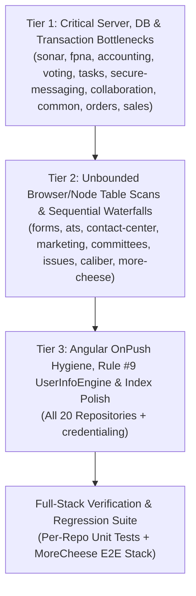

# Post-AIDP BizApps & MoreCheese Performance and Resource Optimization Plan

> [!IMPORTANT]
> **Target Owner**: @bg-BC (Boston Gunderson)
> **Execution Timing**: **Scheduled for execution immediately AFTER AIDP Go-Live**
> **Scope**: All 19 `MemberJunction/bizapps-*` OpenApp repositories + `MemberJunction/more-cheese` (63 code-level findings across server engines, SQL schemas/migrations, GraphQL operations, and Angular UI components)
> **Prerequisite Context**: Follows the core MemberJunction framework optimizations in [`MemberJunction/MJ#5912`](https://github.com/MemberJunction/MJ/pull/5912) (Phase 1) and [`MemberJunction/MJ#5915`](https://github.com/MemberJunction/MJ/pull/5915) (Phase 2).

---

## 1. Executive Context & Why This Runs Post-AIDP Go-Live

During the Phase 3 multi-repository performance and resource utilization audit, every `bizapps-*` repository and `more-cheese` was audited end-to-end against live SQL execution plans, server memory/transaction profiles, and Angular change-detection / network waterfall traces.

To protect release stability during the final **AIDP go-live** window, these application-layer optimizations are intentionally staged as a **post-AIDP execution plan**. Once AIDP is live, executing this plan in the prioritized tiers below will:
- Eliminate **multi-minute database transaction lock timeouts** and **`1,000–50,000` sequential SQL query storms** in batch/recompute engines (`bizapps-sonar`, `bizapps-fpna`, `bizapps-accounting`, `bizapps-voting`, `bizapps-orders`, `bizapps-common`).
- Prevent **Node.js and browser tab Out-Of-Memory (OOM) crashes** caused by unbounded `IgnoreMaxRows: true` full-table downloads (`bizapps-sonar`, `bizapps-orders`, `bizapps-forms`, `bizapps-ats`, `bizapps-marketing`, `bizapps-committees`).
- Fix **critical correctness + performance bugs**, including double Action hook execution on every task completion/cancellation/rejection (`bizapps-tasks`), blocking `PortalSession.Save()` DB writes on every portal HTTP GET request (`bizapps-secure-messaging`), and cross-user unfiltered query bugs (`bizapps-issues`).
- Add **16 missing nonclustered foreign-key and lookup indexes** across OpenApp SQL schemas and enable `SaveReturnMode: 'datestamps_only'` on high-volume write tables.

---

## 2. Prioritized Execution Roadmap

### Cross-Repository Summary Table

| # | Repository | Priority Tier | Findings | Critical / High | Medium / Low | Headline Resource / Wall-Clock Impact |
| :-: | :--- | :-: | :-: | :-: | :-: | :--- |
| **1** | **`bizapps-common`** | **Tier 1** | `COMMON-1..4` | **3** | **2** | `ActivitySyncEngine` executes `~600` sequential `RunView`s per 200-item sync -> **3 batched queries**; `ActivityLink` `SaveReturnMode: 'datestamps_only'`. |
| **2** | **`bizapps-sonar`** | **Tier 1** | `SONAR-1..3` | **4** | **1** | Eliminates `3.65M`-row `ScoreHistory` OOM scan in `loadTrendBaselines`; cuts `persistAll` from `50,000` sequential saves + `50,000` `RecordChange` audits to chunked `TransactionGroup`s with `TrackRecordChanges = 0`. |
| **3** | **`bizapps-fpna`** | **Tier 1** | `FPNA-1..2` | **2** | **0** | Eliminates $2N$ sequential `Displacements.Load(true)` + `Dimensions.Load(true)` (`2,500+` queries inside one open transaction) that block concurrent readers for minutes. |
| **4** | **`bizapps-accounting`** | **Tier 1** | `ACCT-1..2` | **3** | **0** | Cuts 200-JE batch approval/posting from `1,200+` sequential queries down to **1 batched `RunView` + fast updates** by wiring `AccountingEngine.Instance` into `ValidateAsync()`. |
| **5** | **`bizapps-voting`** | **Tier 1** | `VOTING-1..3` | **2** | **1** | Eliminates `4,000+` sequential SQL statements in `VoterRollEngine.FreezeRoll()` and 3-hop parent loads per option in `TallyEngine`; adds `SaveReturnMode: 'datestamps_only'`. |
| **6** | **`bizapps-tasks`** | **Tier 1** | `TASKS-1..3` | **3** | **0** | Fixes **double Action hook execution bug** (`TaskEntityServer` + `TaskNotificationHandler`); fixes `900+`-query `OverdueTaskNotificationJob` cascade; stops loading `People` twice per mount. |
| **7** | **`bizapps-secure-messaging`** | **Tier 1** | `SECMSG-1..3` | **4** | **0** | Eliminates blocking `session.Save()` + audit log insert + `getContactEmail` query on **every portal HTTP request**; adds **9 missing SQL indexes** (`TokenHash`, `ContactID`). |
| **8** | **`bizapps-collaboration`** | **Tier 1** | `COLLAB-1..4` | **4** | **1** | Eliminates `6x` redundant `Space` + ancestor-chain SQL walks (`15+` queries) before every `AgentRunner.RunAgent` chat turn; batches `room-edit-grants` N+1 mutations. |
| **9** | **`bizapps-orders`** | **Tier 1** | `ORDERS-1..3` | **3** | **0** | Bounds `15,104+`-row `GetOrdersList()` scan; memoizes `12+` getters in `OrdersDashboardPageComponent` (`180,000+` row scans/event); batches `TaxResolver` & `PromotionEngine` (`70–90` queries -> batched `IN`). |
| **10** | **`bizapps-sales`** | **Tier 1** | `SALES-1..2` | **2** | **0** | Introduces `SalesEngineBase` to eliminate `6–10` uncached lookup `RunView`s per `Deal.Save()`; replaces $O(N^2 \log N)$ `IsSlipped(row)` template getter with $O(1)$ `Set`. |
| **11** | **`bizapps-forms`** | **Tier 2** | `FORMS-1..4` | **4** | **1** | Replaces `200,000+`-row browser download in `ResponsesDataService` with server-side aggregation; converts `~160` sequential saves in `FormCloneService` to single-pass `TransactionGroup`. |
| **12** | **`bizapps-ats`** | **Tier 2** | `ATS-1..3` | **4** | **1** | Replaces `IgnoreMaxRows: true` full-table JS grouping in `GetPipelineCounts` & `GetRefusedIntake` with SQL views; collapses 15-step `Candidate360` waterfall; adds 4 cross-app FK indexes + `NotifyLoadComplete()`. |
| **13** | **`bizapps-contact-center`** | **Tier 2** | `CC-1..3` | **2** | **1** | Bounds `LoadPendingTargets` on dialer ticks; hoists `IsQueueWithinBusinessHours` (`5` SQL queries) out of per-entry callback loop (`250` -> `5` queries) and uses `ContactCenterEngine`. |
| **14** | **`bizapps-marketing`** | **Tier 2** | `MKTG-1..3` | **3** | **1** | Scopes cross-brand full-table scans on `Sprint Programs` & `Program Segment Results`; parallelizes 18-step `GetProgramContextAction` waterfall; drops markdown body retention in `BlogEmbeddingCache`. |
| **15** | **`bizapps-committees`** | **Tier 2** | `COMMITTEES-1..2` | **2** | **0** | Scopes `MotionService.GetRegister()` & `CommitteeWorkspaceComponent` by `CommitteeID` instead of loading all global motions/meetings/votes/tasks; gates `1Hz` timer in `LiveMeetingComponent`. |
| **16** | **`bizapps-issues`** | **Tier 2** | `ISSUES-1..2` | **1** | **1** | Wires `IssueEngine.Instance` cache into Angular pages; adds missing user filter to `MyIssuesPageComponent`; switches KPIs to `ResultType: 'count_only'`; pushes `searchTerms` to SQL in `FindSimilarIssues`. |
| **17** | **`bizapps-caliber`** | **Tier 2** | `CALIBER-1..2` | **3** | **2** | Parallelizes dual-LLM calls in `EvaluateWithConsistencyCheck` (`2x` latency speedup) and `digest` + `eval` in `CaliberClosePipeline`; batches `3,000+` artifact deletions in `RetentionDeletionDriver`. |
| **18** | **`more-cheese`** | **Tier 2** | `MORECHEESE-1..3` | **2** | **1** | Adds missing `IDX_AUTO_MJ_FKEY_AdvocacyAction_PersonID` index; bounds `MJ: Process Run Details` payload fetch + lazy JSON formatting; optimizes `vwMemberRenewalSignals`. |
| **19** | **`bizapps-contracts`** | **Tier 3** | `CONTRACTS-1..2` | **1** | **2** | Switches 500–1,000 ID row fetches to `ResultType: 'count_only'`; bounds `ModificationsPageComponent`; removes dynamic `await import('@memberjunction/core')`; adds `OnPush` to 11 components. |
| **20** | **`bizapps-credentialing`** | **Tier 3** | `CRED-1` | **0** | **1** | Adds `ChangeDetectionStrategy.OnPush` and removes unused `CommonModule` in `CredentialingOverviewResource`. |

---

## 3. Detailed Per-Repository Implementation Specifications

### Repository 1: `bizapps-common`

#### COMMON-1 (CRITICAL): Redundant N+1 `ContactMethod` Queries & Unbatched Per-Item `ActivityType` / `Activities` Lookups in `ActivitySyncEngine`
- **Files**:
  - `packages/ActivitySync/src/ActivitySyncEngine.ts` (lines `417–462`, `554`, `743–765`)
  - `packages/ActivitySync/src/identity.ts` (lines `39–100`)
  - `packages/ActivitySync/src/writer.ts` (lines `205–211`, `505–578`)
- **Root Cause**:
  1. `ActivitySyncEngine.resolvePeopleByEmails()` (`ActivitySyncEngine.ts:743-765`) calls `resolveEmailsToPersonIDs()` (`identity.ts:39-100`) to batch-resolve participant emails to `PersonID`s before the loop (`line 417`).
  2. Immediately afterward, inside `for (const entry of included)` (`line 422`), `buildParticipants()` (`line 554`) calls `resolveEmailsToPersonIDs(allEmails, contextUser)` **again for every single included item**, re-querying `MJ_BizApps_Common: Contact Methods` via `RunView` instead of reusing the `emailToPersonID` `Map` already computed at `line 417`.
  3. Inside the same loop (`line 425`), `resolveActivityTypeID(typeCode, contextUser)` (`writer.ts:505-527`) executes an uncached `RunView` on `MJ_BizApps_Common: Activity Types` per item (`N` times per sync run).
  4. In `writeActivityItem()` (`writer.ts:205-211, 534-578`), `findExistingActivity()` executes a per-item `RunView` on `MJ_BizApps_Common: Activities` (`SourceSystem = ... AND ExternalID = ...`) instead of batch-prefetching existing `(ExternalID, ID)` pairs via `ExternalID IN (...)`.
- **Quantified Impact**: For a 200-item sync batch, reduces `RunView` calls from **~600 sequential queries down to 3 batched queries**.
- **Concrete Implementation**:
  1. Pass `emailToPersonID: Map<string, string>` from `runSync()` (`line 417`) directly into `buildParticipants(entry, emailToPersonID)` and remove the per-item `resolveEmailsToPersonIDs` call at `line 554`.
  2. Preload `MJ_BizApps_Common: Activity Types` once per sync run (`Fields: ['ID', 'Code'], ResultType: 'simple'`) into a `Map<string, string>` and pass it into `writeActivityItem()`.
  3. Before the per-item write loop, batch-fetch existing `Activities` for the chunk using `SourceSystem = '${sourceSystem}' AND ExternalID IN (${quotedExternalIds})` with `Fields: ['ID', 'ExternalID'], ResultType: 'simple'`, and pass the `existingActivityIdByExternalId` map into `writeActivityItem()`.
- **Regression Guard**: Add a unit test in `packages/ActivitySync/src/__tests__/` spying on `RunView.prototype.RunView` for a 50-item sync batch and asserting total `RunView` invocations for `Contact Methods`, `Activity Types`, and `Activities` is `<= 3` (not proportional to `N`).

#### COMMON-2 (HIGH): Sequential `RunView` Waterfalls, `ResultType: 'entity_object'` for Read-Only Lookups, & Duplicate `loadData()` Call in Shared Angular Widgets
- **Files**:
  - `packages/Angular/src/lib/components/relationship-list/relationship-list.component.ts` (lines `385–489`)
  - `packages/Angular/src/lib/components/org-hierarchy-tree/org-hierarchy-tree.component.ts` (lines `81–174`)
  - `packages/Angular/src/lib/components/contact-method-list/contact-method-list.component.ts` (lines `205–260`)
  - `packages/Angular/src/lib/components/person-job-functions/person-job-functions.component.ts` (lines `69–110`)
- **Root Cause**:
  1. `RelationshipListComponent.loadData()` awaits `loadRelationshipTypes()` and `loadRelationships()` sequentially with `ResultType: 'entity_object'` and no `Fields`; in `saveNew()` (`lines 456–489`), when `CreateInverse` is true, it calls `await this.loadData()` at `line 480` and **calls `await this.loadData()` a second time** at `line 486`.
  2. `OrgHierarchyTreeComponent`, `ContactMethodListComponent`, and `PersonJobFunctionsComponent` load lookup catalogs (`Relationship Types`, `Contact Types`, `Job Functions`) with `ResultType: 'entity_object'` on every mount instead of `ResultType: 'simple'` (or a cached `BaseEngine`).
- **Concrete Implementation**:
  1. Batch independent reads via `rv.RunViews([...])` in `RelationshipListComponent.loadData()`, `OrgHierarchyTreeComponent`, `ContactMethodListComponent`, and `PersonJobFunctionsComponent`.
  2. Switch read-only lookup queries to `ResultType: 'simple'` with explicit `Fields`.
  3. Remove the duplicate `await this.loadData()` inside the `if (this.CreateInverse)` block at `relationship-list.component.ts:480` so `loadData()` runs once at `line 486`.

#### COMMON-3 (HIGH): `CommonActivitiesPageComponent` Unprojected 250-Row `RunView`, Truncated Client-Side KPIs, & Missing `OnPush` Across All 7 Components
- **Files**:
  - `packages/Angular/src/lib/pages/activities-dashboard.page.ts` (lines `62–121`, `608–668`)
  - `packages/Angular/src/lib/pages/common-dashboard.page.ts` (lines `30–34`, `575–583`)
  - `packages/Angular/src/lib/pages/organizations-list.page.ts`
  - `packages/Angular/src/lib/pages/people-list.page.ts`
- **Root Cause & Implementation**:
  1. `CommonActivitiesPageComponent.LoadData()` (`lines 623–630`) fetches `Activities` (`MaxRows: 250`) with no `Fields` projection (pulling large `Body`/`Description`/`MetadataJSON` columns), computes `TotalActivities` and `ActivePeopleCount` over only that 250-row slice (`lines 641–656`), and evaluates unmemoized `get FilteredActivities()` twice per CD cycle (`lines 113, 121`).
  2. Project only list scalar columns in `Fields` (loading `Body`/`MetadataJSON` only when opening the detail drawer), compute total KPI counts via `ResultType: 'count_only'` in `rv.RunViews`, memoize `FilteredActivities` and `GetBarPercent`, and add `changeDetection: ChangeDetectionStrategy.OnPush` across all Angular components in `bizapps-common`.

#### COMMON-4 (MEDIUM): `ActivityLink` Missing `SaveReturnMode: 'datestamps_only'` & Correlated Subqueries in `vwPeople` / `vwOrganizations`
- **Files**:
  - `migrations/V202610171645__v5.55.x__SaveReturnMode_DatestampsOnly_StoredProcedures.sql` (lines `29–32`)
  - `migrations/V202609290300__v5.48.x__People_Organization_Lookup_Search_Performance.sql` (lines `141–226`)
- **Root Cause & Implementation**:
  1. Enable `SaveReturnMode: 'datestamps_only'` on `MJ_BizApps_Common: Activity Links` (which is inserted $2\text{–}5\times$ per `Activity` in `writer.ts:276-360`).
  2. Widen `IX_Relationship_ToID_RelationshipTypeID` to `(ToID, Status, RelationshipTypeID, IsPrimary DESC, StartDate DESC) INCLUDE (FromID)` in a new migration so the `ORDER BY r.IsPrimary DESC, r.StartDate DESC` correlated subquery in `vwPeople` is satisfied by a single index seek without a sort/key-lookup.

---

### Repository 2: `bizapps-sonar`

#### SONAR-1 (CRITICAL): Unbounded Multi-Million Row `ScoreHistory` Scan with `ResultType: 'entity_object'` in `ScorePersister.loadTrendBaselines` (Guaranteed OOM)
- **File**: `packages/Engine/src/orchestration/ScorePersister.ts` (lines `440–457`)
- **Root Cause**:
  `loadTrendBaselines` queries `MJ_BizApps_Sonar: Score Histories` with `ExtraFilter: ScoreModelID='${model.ID}' AND AsOfDate <= '${cutoff.toISOString()}'`, `ResultType: 'entity_object'`, and `IgnoreMaxRows: true`. Because `ScoreHistory` is an append-only log that inserts $N$ rows on every recompute run, after 1 year of daily runs on 10,000 members, `ScoreHistory` holds **3.65 million rows**. Every recompute run fetches all 3.65 million rows and instantiates 3.65 million `BaseEntity` objects in Node memory just so `latestBaselinePerAnchor` can pick the single most recent pre-cutoff `TotalScore` per `AnchorRecordID`.
- **Quantified Impact**: Prevents multi-gigabyte Node.js heap exhaustion and reduces baseline lookup rows from $O(\text{runs} \times N)$ to $O(N)$.
- **Concrete Implementation**:
  1. Bound the lower date window (`AsOfDate >= '${windowStart.toISOString()}' AND AsOfDate <= '${cutoff.toISOString()}'`) or query an indexed SQL view / CTE using `ROW_NUMBER() OVER (PARTITION BY ScoreModelID, AnchorRecordID ORDER BY AsOfDate DESC) = 1`.
  2. Switch `ResultType` from `'entity_object'` to `'simple'` with `Fields: ['AnchorRecordID', 'TotalScore', 'AsOfDate']`.
- **Regression Guard**: Add a unit test in `packages/Engine/src/__tests__/ScorePersister.test.ts` asserting `loadTrendBaselines` uses `ResultType: 'simple'`, specifies `Fields: ['AnchorRecordID', 'TotalScore', 'AsOfDate']`, and bounds the query window.

#### SONAR-2 (CRITICAL): Sequential Per-Record N+1 `Save()`/`Delete()` Storm (`50,000` SQL Round-Trips/Run) + `TrackRecordChanges = 1` on Derived Score Tables
- **Files**:
  - `packages/Engine/src/orchestration/ScorePersister.ts` (lines `119–380`)
  - `migrations/B202607151200__v1.0.0_Sonar_Baseline.sql` (`TrackRecordChanges` on `Score`, `ScoreFactorContribution`, `ScoreHistory`)
- **Root Cause**:
  1. `persistAll` loops sequentially over every anchor (`for (const computed of output.scores)`), awaiting `score.Save()`, then sequentially deleting/upserting each `ScoreFactorContribution` one by one (`replaceContributions`, `lines 280–345`), then awaiting `history.Save()`.
  2. Furthermore, `Score`, `ScoreFactorContribution`, and `ScoreHistory` have `TrackRecordChanges = 1` and `SaveReturnMode = 'full'`, triggering JSON diffing and inserting an `MJ: Record Changes` audit row on every single derived score write (`~100,000` SQL statements in series for 5,000 members $\times$ 8 factors).
- **Concrete Implementation**:
  1. Batch entity saves/deletes in chunked `TransactionGroup`s (e.g. 50–100 anchors per batch) in `ScorePersister.persistAll`.
  2. Author a migration setting `TrackRecordChanges = 0` and `SaveReturnMode = 'datestamps_only'` on derived high-churn tables `Score`, `ScoreFactorContribution`, and `ScoreHistory` (since `ScoreHistory` is itself the historical audit trail).

#### SONAR-3 (HIGH): Full-Population `Score` Download into Browser Memory for Band Distribution, Duplicate `ValidateAsync`/Lock Queries, `localStorage` Rule #9 Violation, & All 19 Components Missing `OnPush`
- **Files**:
  - `packages/Angular/src/lib/custom/core/services/score-read.service.ts` (lines `155–170`, `267`, `412–417`, `531–539`, `597–624`)
  - `packages/CoreEntitiesServer/src/ScoreModelEntityServer.ts` (lines `320–344`)
  - `packages/Angular/src/lib/custom/overview/sonar-overview-resource.component.ts` (lines `134–139`)
- **Root Cause & Implementation**:
  1. Replace `loadAllScores(modelId)` (`ResultType: 'entity_object', IgnoreMaxRows: true`) in `ScoreReadService.distributionForModel` with `ResultType: 'count_only'` queries per band batched in a single `rv.RunViews(...)` call.
  2. Remove the duplicate `await this.ValidateAsync()` call before `super.Save()` in `ScoreModelEntityServer.publishWithSnapshot` (`line 320`), and deduplicate parent lock checks between `Save()` and `ValidateAsync()` in `FactorEntityServer`, `ModelFactorEntityServer`, and `ScoreBandEntityServer`.
  3. Replace `window.localStorage` in `SonarOverviewResourceComponent` (`lines 134, 139`) with `UserInfoEngine.Instance.GetSetting()` / `SetSettingDebounced()` (MJ Rule #9), and add `ChangeDetectionStrategy.OnPush` across all 19 Angular components in `bizapps-sonar`.

---

### Repository 3: `bizapps-fpna`

#### FPNA-1 (CRITICAL): Severe N+1 Child Collection `Load(true)` Loops Inside Open Transaction in `FPNAEngine.materialize()` & `capture()`, Plus N+1 `Snapshot.Load()` Loop in `priorState()`
- **File**: `packages/CoreEntitiesServer/src/FPNAEngine.ts` (lines `360–393`, `461–500`, `688–693`, `952–971`, `1011–1029`)
- **Root Cause**:
  1. In `FPNAEngine.materialize()` (`lines 360–393`), when `ReplaceExisting: true` is passed, it opens a database transaction (`await db.BeginTransaction()`) and loops sequentially over every existing `ForecastLine` (`for (const line of [...(run.Lines.Items)])`), awaiting `await line.Displacements.Load(true)` and `await line.Dimensions.Load(true)` per line (**$2N$ sequential `RunView` calls with `ResultType: 'entity_object'`**), and then `run.Save()` deletes each child and line one by one via individual stored procedure calls (**$3N$ sequential SQL statements inside the open transaction**). This directly causes the multi-minute lock contention documented in `cash-flow-dashboard.component.ts:520` (*"The first read routinely blocks behind the materialize transaction and times out"*).
  2. `FPNAEngine.capture()` (`lines 688–692`) similarly runs $2N$ sequential `line.Displacements.Load(true)` and `line.Dimensions.Load(true)` calls.
  3. `priorState()` (`lines 1011–1029`) loads all `SnapshotStates` for `DistributionYear` and loops sequentially calling `await snap.Load(state.SnapshotID)` (`line 1025`) to check `snap.CompanyID`.
- **Quantified Impact**: For a 500-line forecast run, reduces child collection loading from **1,000 sequential `RunView`s inside an open transaction down to 2 batched `RunView`s** before opening the write transaction.
- **Concrete Implementation**:
  1. Bulk-load `ForecastLineDisplacements` and `ForecastLineDimensions` in a single `rv.RunViews` batch (`ExtraFilter: "ForecastLineID IN (SELECT ID FROM [__mj_BizAppsFPNA].[vwForecastLines] WHERE RunID = '...')"`) before `db.BeginTransaction()` in both `materialize()` and `capture()`.
  2. Push date bounds into `loadOwnedFacts()` and `latestCashBalance()` (`MaxRows: 1, OrderBy: 'AsOfDate DESC', ResultType: 'simple'`).
  3. Filter `SnapshotStates` in `priorState()` directly in SQL using `SnapshotID IN (SELECT ID FROM [__mj_BizAppsFPNA].[vwSnapshots] WHERE CompanyID = '${companyID}')` to eliminate the per-state `snap.Load()` loop.

#### FPNA-2 (HIGH): 6-Stage `RunView` Waterfall + Redundant Per-Company `GetCashPosition` RPC Fan-Out in `LoadCashFlowSession()`, & Missing `OnPush` in `CashFlowMatrixComponent`
- **Files**:
  - `packages/Angular/src/lib/data/cash-flow-session.ts` (lines `76–211`)
  - `packages/Angular/src/lib/dashboard/cash-flow-matrix.component.ts` (lines `48–54`, `121–122`)
- **Root Cause & Implementation**:
  1. `LoadCashFlowSession()` fires 4 separate `RunView`s, then $N$ `GetCashPosition` GraphQL RPCs (even though `CashBalances` was already loaded at `line 107`), then 5 more sequential `RunView`s (`Snapshots`, `PriorSnapshots`, `Bridges`, `BridgeLines`, `SnapshotStates`). Collapse into 2 `rv.RunViews([...])` batches and derive initial cash positions from the loaded `CashBalances` rows.
  2. Add `ChangeDetectionStrategy.OnPush` to `CashFlowMatrixComponent`, and index `Streams` and `ForecastCategories` in `Map`s before the `10,000`-line loop in `recalculate()`.

---

### Repository 4: `bizapps-accounting`

#### ACCT-1 (CRITICAL): Server-Side N+1 Entity Load + Save Loops Triggering 3–4 Redundant `BypassCache: true` Validation `RunView`s per Journal Entry (`1,200+` Queries per 200-JE Batch)
- **Files**:
  - `packages/CoreEntitiesServer/src/JournalEntryBatchEngine.ts` (lines `808–966`, `1698–1715`)
  - `packages/CoreEntitiesServer/src/JournalEntryEntityServer.ts` (lines `270–395`)
  - `packages/CoreEntitiesServer/src/JournalEntryLineEntityServer.ts` (lines `210–223`)
  - `packages/CoreEntitiesServer/src/AccountingEngine.ts` (lines `110–165`)
- **Root Cause**:
  1. `AccountingEngine` (`AccountingEngine.ts:110-165`) already caches `Accounts`, `AccountTypes`, `FiscalYears`, `FiscalPeriods`, `Ledgers`, and `PostingRuleTemplates` via `BaseEngine`.
  2. Yet `JournalEntryEntityServer.ValidateAsync()` (`JournalEntryEntityServer.ts:270-395`) completely bypasses `AccountingEngine.Instance` and executes **3 to 4 sequential `rv.RunView(..., { BypassCache: true })` queries on every single `JournalEntry.Save()`** (`Journal Entry Lines`, `Fiscal Periods`, `Fiscal Years`, and duplicate `EntryNumber` check) — even when only `BatchStatus` or `Status` is being updated on an already-saved JE.
  3. Similarly, `JournalEntryLineEntityServer.ValidateAsync()` (`lines 210–223`) runs a `BypassCache: true` `RunView` on `Accounts` on every line save instead of `AccountingEngine.Instance.GetAccountByID(this.AccountID)`.
  4. In `JournalEntryBatchEngine` (`ApproveBatch`, `PostBatchToGL`, `MarkDispatched`, `ConfirmPostedInTarget`), `loadBatchJournalEntries()` (`lines 958–966`) loads `ID`s via `RunView` and then loops sequentially calling `await je.Load(row.ID)` ($N$ queries), and then the caller loops sequentially calling `await je.Save()` ($N$ saves $\times$ 4 validation `RunView`s each).
- **Quantified Impact**: Approving or posting a 200-JE batch drops from **1,200+ sequential DB round-trips down to 1 batched `RunView` (`ResultType: 'entity_object'`) + 200 fast updates (`>80%` reduction)**.
- **Concrete Implementation**:
  1. Read `FiscalPeriod`, `FiscalYear`, and `Account` from `AccountingEngine.Instance` in `JournalEntryEntityServer.ValidateAsync()` and `JournalEntryLineEntityServer.ValidateAsync()`.
  2. In `JournalEntryEntityServer.ValidateAsync()`, skip the duplicate `EntryNumber` `RunView` when `this.IsSaved && !this.GetFieldByName('EntryNumber')?.Dirty`, and skip re-querying `Journal Entry Lines` when `this.IsSaved` and only batch status/dispatch workflow fields are dirty.
  3. In `JournalEntryBatchEngine.loadBatchJournalEntries()`, load the `JournalEntry` entities in a single `rv.RunView({ EntityName: 'MJ_BizApps_Accounting: Journal Entries', ExtraFilter: ..., ResultType: 'entity_object' })` call instead of `ID`-only `RunView` + $N$ `je.Load(id)` calls.

#### ACCT-2 (HIGH): Unbounded `BatchID IS NOT NULL` JE History Fetch, Duplicate Batch Query, & N+1 `GetBatchApprovalState` RPC Fan-Out in Batch Dashboards
- **Files**:
  - `packages/Angular/src/lib/custom/JournalEntryBatchStatus/journal-entry-batch-status-dashboard.component.ts` (lines `229–254`, `353–428`)
  - `packages/Angular/src/lib/custom/JournalEntryBatchDispatch/journal-entry-batch-dispatch-dashboard.component.ts` (lines `355–398`)
  - `packages/Angular/src/lib/custom/overview/accounting-overview.component.ts` (lines `704–838`)
- **Root Cause & Implementation**:
  1. Scope `Journal Entries` in `JournalEntryBatchStatusDashboardComponent.LoadData()` (`lines 359–388`) to `BatchID IN (${loadedBatchIds})` with explicit scalar `Fields`, and look up the selected batch from `this.allBatches` in `loadBatchDetail()` (`lines 229–254`) instead of re-querying `Journal Entry Batches`.
  2. Lazy-load `GetBatchApprovalState` only for the selected batch in `JournalEntryBatchDispatchDashboardComponent` instead of firing $N$ RPCs on page load.
  3. Batch the 5 `RunView` calls in `AccountingOverviewPageComponent.loadAll()` into a single `rv.RunViews([...])` call with minimal `Fields`.

---

### Repository 5: `bizapps-voting`

#### VOTING-1 (CRITICAL): Server-Side N+1 Entity Load & Save Loops Inside Open Transactions (`VoterRollEngine.FreezeRoll` Runs `4,000+` Queries in 1 Transaction; `TallyEngine` Runs 3-Hop Parent Loads per Option)
- **Files**:
  - `packages/Server/src/engines/voter-roll-engine.ts` (lines `120–129`, `194–229`, `450–462`)
  - `packages/Server/src/engines/tally-engine.ts` (lines `200–212`, `454–499`)
  - `packages/Server/src/engines/credential-engine.ts` (lines `120–130`, `155–163`, `214–227`)
  - `packages/CoreEntitiesServer/src/entity-support.ts` (lines `48–73`, `84–92`)
  - `packages/CoreEntitiesServer/src/entity-servers.ts` (lines `288–293`, `358–377`, `519–554`)
- **Root Cause**:
  1. In `entity-support.ts:48-73, 84-92`, `LoadRelated()` calls `GetEntityObject()` + `row.Load(id)` on every call without any per-transaction or engine cache (`ResolveElectionType` at `lines 84–92` loads `Election Types` from SQL instead of `VotingEngineBase.Instance.GetElectionTypeByID()`).
  2. When `VoterRollEngine.FreezeRoll()` (`voter-roll-engine.ts:121`) loops `for (const entry of toInsert) await this.insertVoter(...)` for $N = 2,000$ voters inside a single transaction, `EligibleVoterEntityServer.ValidateAsync()` (`entity-servers.ts:368`) calls `await LoadElection(this, electionId)` on **every single voter save** — executing **2,000 redundant `SELECT * FROM vwElections` queries + 2,000 `spCreateEligibleVoter` calls sequentially inside one open transaction (`4,000+` SQL statements)**.
  3. When `TallyEngine.Tally()` (`tally-engine.ts:454-499`) writes `BallotSelections`, `ContestResults`, and `ContestOptionResults` sequentially in nested `for` loops inside one transaction, each `ContestResult.Save()` (`entity-servers.ts:527`) calls `LoadElectionOfContest` (2 DB loads) and each `ContestOptionResult.Save()` (`entity-servers.ts:547`) calls `LoadElectionOfContestResult` (**3 sequential DB loads per option**: `ContestResult` -> `Contest` -> `Election`).
  4. `CredentialEngine` (`IssueControlNumbers`, `IssueSecondFactorPins`, `IssueCredentials`) loops sequentially calling `await RevokeLiveCredentials(...)` (`RunView` + `Save` per voter) + `await InsertCredential(...)`.
- **Concrete Implementation**:
  1. Use `VotingEngineBase.Instance.GetElectionTypeByID()` in `ResolveElectionType()`.
  2. Short-circuit redundant parent `Election` re-loads in `EligibleVoterEntityServer.ValidateAsync()`, `ContestResultEntityServer.ValidateAsync()`, and `ContestOptionResultEntityServer.ValidateAsync()` when `TallyWriteGuard.HasTallyAccess()` or a `RollWriteGuard` is active (the engine already validated the parent `Election` before entering the guard), or cache parent `Election`/`Contest` lookups per guard scope.
  3. Batch-prefetch live credentials via `EligibleVoterID IN (...)` with `ResultType: 'entity_object'` in `CredentialEngine` instead of running a separate `RunView` per voter.

#### VOTING-2 (HIGH): N+1 `GetMyParticipation` RPC Fan-Out in `VotingBallotResourceComponent`, Duplicate Election Query in `VotingElectionsResource`, & Missing `OnPush`
- **Files**:
  - `packages/Angular/src/lib/ballot/ballot.resource.ts` (lines `37–48`, `160–205`)
  - `packages/Angular/src/lib/elections/elections.resource.ts` (lines `62–77`, `287–288`, `307–330`, `388–393`)
  - `packages/Angular/src/lib/results/results.resource.ts` (lines `297–336`)
- **Root Cause & Implementation**:
  1. Replace the $N$ separate `GetMyParticipation({ ElectionID })` GraphQL RPC calls in `VotingBallotResourceComponent.LoadOpenElections()` (`ballot.resource.ts:165-205`) with a single batched lookup across all open `ElectionID`s.
  2. Reuse the already-loaded election row from `this.Elections` in `VotingElectionsResource.LoadSelected()` (`elections.resource.ts:388-393`), memoize `get TabInputs()`, and add `ChangeDetectionStrategy.OnPush` across all Voting Angular components.

#### VOTING-3 (MEDIUM): High-Volume Voting Tables (`CastBallots`, `BallotSelections`, `Participations`, `ContestRunningTallies`, `ElectionAuditEvents`) Missing `SaveReturnMode: 'datestamps_only'`
- **File**: `migrations/V202610122252__v0.1.x__Voting_Core_Schema.sql`
- **Root Cause & Implementation**: Author a migration setting `SaveReturnMode = 'datestamps_only'` on `CastBallots`, `BallotSelections`, `Participations`, `BallotAttributions`, `ContestRunningTallies`, and `ElectionAuditEvents` so ballot casting and tallying do not execute `SELECT * FROM vw...` after every insert/update.

---

### Repository 6: `bizapps-tasks`

#### TASKS-1 (CRITICAL): Duplicate Action Hook Execution Bug & Redundant Uncached `TaskType` / `TaskTypeStatus` DB Lookups on Every `Task.Save()`
- **Files**:
  - `packages/EntitiesServer/src/TaskEntityServer.ts` (lines `82–148`, `184–369`, `454–489`)
  - `packages/Server/src/event-handlers/TaskNotificationHandler.ts` (lines `94–110`, `132–213`, `377–431`)
- **Root Cause**:
  1. **Double Action Hook Firing Bug + Duplicate Work**: Both `TaskEntityServer.dispatchLifecycleActionHooks()` (`TaskEntityServer.ts:329-357`) AND `TaskNotificationHandler.handleTaskSave()` (`TaskNotificationHandler.ts:159, 182`) listen to `MJ_BizApps_Tasks: Tasks` saves and **both invoke `OnCompleteActionID`, `OnCancelActionID`, and `OnRejectActionID`**, causing configured completion/cancellation/rejection MJ Actions to execute **twice** on every status transition.
  2. On every `Task.Save()`, `syncTaskTypeStatusPreSave()` (`line 121`) loads `TaskTypeStatus` via `entity.Load()`, and then `dispatchLifecycleActionHooks()` (`lines 264–276, 315`) unconditionally loads `TaskType` and re-loads `TaskTypeStatus` 1–2 more times from SQL because there is no `BaseEngine` cache for `TaskTypes` and `TaskTypeStatuses`.
- **Concrete Implementation**:
  1. Remove the duplicate `OnCompleteActionID`, `OnCancelActionID`, and `OnRejectActionID` invocation from `TaskNotificationHandler.ts:159, 182` (keeping `TaskEntityServer.dispatchLifecycleActionHooks()` as the single authoritative lifecycle hook dispatcher).
  2. Create `TasksEngineBase extends BaseEngine<TasksEngineBase>` caching `TaskTypes`, `TaskTypeStatuses`, `TaskRoles`, and `TaskDecisionOutcomes` (`CacheLocal: true`), and read from it in `TaskEntityServer` and `TaskNotificationHandler`.
  3. Parallelize independent activity writes in `logActivities()` with `Promise.all`.

#### TASKS-2 (CRITICAL): 6-Level N+1 Query Cascade in `OverdueTaskNotificationJob` (`900+` Queries per 100 Tasks) & `any`/`.Get()`/`.Set()` Rule #2/#2b Violations in `TaskTemplateService`
- **Files**:
  - `packages/Server/src/scheduled-jobs/OverdueTaskNotificationJob.ts` (lines `70–98`, `167–381`)
  - `packages/Core/src/services/TaskTemplateService.ts` (lines `39–95`, `136–205`)
- **Root Cause & Implementation**:
  1. `OverdueTaskNotificationJob` runs an unbounded `RunView` on `Tasks` and then per task queries `Task Assignments`, `People` per assignee + creator, `Task Types`, saves notifications/logs sequentially, and runs a dynamic `await import('@memberjunction/core')` (`line 371`) inside the loop to load and re-save each `Task`. Replace with static top-level imports, batch-prefetch `Task Assignments` (`TaskID IN (...)`), `People` (`ID IN (...)`), and `Task Types` (from `TasksEngineBase`) before the loop, and load overdue `Tasks` with `ResultType: 'entity_object'` initially so marking them notified does not require re-loading each task.
  2. In `TaskTemplateService.instantiateTemplate()`, batch-load `Task Template Item Roles` via `TaskTemplateItemID IN (...)`, pass the already-loaded `Task Template Items` array into `createDependencies()` instead of re-querying SQL, and replace all `any` annotations and `.Get()`/`.Set()` calls (`lines 56–85, 102, 152–203`) with strongly-typed generated entity properties (MJ Rules #2 and #2b).

#### TASKS-3 (HIGH): `TaskListComponent` Downloads the Entire `MJ_BizApps_Common: People` Table Twice per Mount & Runs $O(N^2)$ Hierarchy Scans
- **Files**:
  - `packages/Angular/src/lib/components/task-list/task-list.component.ts` (lines `696–700`, `815–832`, `921–1081`)
  - `packages/Angular/src/lib/pages/tasks-dashboard.page.ts` (lines `419–463`)
- **Root Cause & Implementation**:
  1. `TaskListComponent` calls `loadQuickAddPeople()` (`lines 824–829`, unbounded `RunView` on `People`) AND `loadAssignees()` (`lines 1017–1020`, a second unbounded `RunView` on `People`). Scope `People` in `loadAssignees()` to `ID IN (${assigneeRecordIDs})` with `Fields: ['ID', 'FirstName', 'LastName']`, and bound `loadQuickAddPeople()` with `MaxRows: 100, Fields: ['ID', 'FirstName', 'LastName', 'Email']` (or lazy search).
  2. Batch `loadAssignees` + `loadTags` via `rv.RunViews`, and index tasks in a `Map<string, TaskRow>` by `ID` to eliminate $O(N^2)$ `rawTasks.find(...)` / `this.tasks.find(...)` inside loops (`lines 962, 1040, 1074`).

---

### Repository 7: `bizapps-secure-messaging`

#### SECMSG-1 (CRITICAL): Unconditional `session.Save()` Write + Audit Log Insert + `getContactEmail` Lookup on **Every Portal HTTP Request**
- **Files**:
  - `packages/Core/src/services/PortalAuthService.ts` (lines `250–294`, `306–310`, `354–356`)
  - `packages/Server/src/handlers/middleware.ts` (lines `16–82`)
  - `packages/Server/src/handlers/fileRequests.ts` (lines `27–45`)
- **Root Cause**:
  1. `portalAuthMiddleware` calls `PortalAuthService.Instance.validateSessionToken(token, systemUser)` on **every single portal HTTP request**.
  2. `validateSessionToken` (`lines 260–287`) loads `Portal Sessions` with `ResultType: 'entity_object'`, **unconditionally calls `await session.Save()` on every request** (`line 285` — triggering 4 concurrent `spUpdatePortalSession` writes + `MJ: Record Changes` audit writes whenever the portal widget loads `/threads`, `/messages`, `/attachments`, and `/file-requests` in parallel), and then calls `await this.getContactEmail(session.ContactID, systemUser)` (`line 287` — a 2nd DB round-trip to `People` on every request), followed by `assertThreadAccess` (`middleware.ts:62-82`, a 3rd `RunView` on `Secure Threads`).
- **Concrete Implementation**:
  1. Throttle `LastAccessedAt` updates in `validateSessionToken`: only load the entity and call `session.Save()` when `!session.LastAccessedAt || Date.now() - new Date(session.LastAccessedAt).getTime() > 5 * 60_000` (5 minutes), and fire the throttled update non-blockingly (`void ...`).
  2. Cache validated `(tokenHash -> { session, contactEmail, expiresAt })` in a short-TTL (e.g. 30-second) in-memory map in `PortalAuthService` (invalidated on logout/revocation) so parallel widget GET requests do not hit SQL repeatedly.
  3. Switch `getFileRequests` (`fileRequests.ts:27-45`) from `ResultType: 'entity_object'` to `ResultType: 'simple'`.

#### SECMSG-2 (CRITICAL): 9 Missing Critical Lookup & Soft-FK Indexes in Baseline Migration (`PortalSession.TokenHash`, `PortalMagicLink.TokenHash`, `SecureThread.ContactID`, etc.)
- **File**: `migrations/V202607201423__v1.0.0__Baseline_Schema.sql` (lines `38–125`)
- **Root Cause**: The baseline migration creates **zero** non-FK indexes. High-frequency lookup and soft-FK columns perform full table scans on every query:
  1. `PortalSession.TokenHash` (`line 53` — queried on every portal HTTP request)
  2. `PortalMagicLink.TokenHash` (`line 65` — queried on magic link redemption)
  3. `SecureThread.ContactID` (`line 38` — queried on every portal HTTP request)
  4. `PortalSession.ContactID` (`line 52`)
  5. `SecureMessage.PersonID` (`line 81`)
  6. `SecureMessage.ExternalMessageID` (`line 89` — queried on webhook/inbound dedup)
  7. `MessageFile.ArtifactID` (`line 107`)
  8. `MessageFile.FileID` (`line 108`)
  9. `FileRequest.RequestedByUserID` (`line 125`)
- **Concrete Implementation**: Author a new additive migration creating nonclustered indexes on all 9 columns (including composite `(TokenHash, IsRevoked, ExpiresAt)` on `PortalSession` and `(ContactID, IsDeleted)` on `SecureThread`).

#### SECMSG-3 (HIGH): Full-History Message Fetch (`Content` Blob), Duplicate Session Query, Eager Hidden-Tab Loads, Sequential `importMessages` Saves, `localStorage` Rule #9 Violation, & All 10 Components Missing `OnPush`
- **Files**:
  - `packages/Angular/src/lib/secure-messaging-client-workspace.component.ts` (lines `486–639`, `749`, `1058–1068`)
  - `packages/Angular/src/lib/secure-messaging-executive.component.ts` (lines `2044`, `2289–2348`, `2413–2444`)
  - `packages/Core/src/stores/OwnedMessageStore.ts` (lines `181–208`)
  - `packages/Core/src/stores/ChannelMessageStore.ts` (lines `154–178`)
- **Root Cause & Implementation**:
  1. In `SecureMessagingClientWorkspaceComponent.loadThreads` (`lines 609–639`), stop fetching all `SecureMessage` rows (and `Content` `NVARCHAR(MAX)`) across all of a contact's threads just to count messages; project only `['ID', 'ThreadID', 'SentAt']` or use thread summary fields, reuse loaded sessions in `loadAudit` (`line 749`), skip eager hidden-tab queries when `mode === 'basic'` (`lines 518–538`), and replace `localStorage` (`lines 486, 500`) with `UserInfoEngine.Instance` (Rule #9).
  2. Batch the 5 sequential `RunView`s in `SecureMessagingExecutiveComponent.loadMessages` (`lines 2413–2444`) into `rv.RunViews` with explicit `Fields`.
  3. Batch message creates in `OwnedMessageStore.importMessages` and `ChannelMessageStore.importMessages` using `TransactionGroup`, and add `ChangeDetectionStrategy.OnPush` across all 10 Angular components.

---

### Repository 8: `bizapps-collaboration`

#### COLLAB-1 (CRITICAL): 6x Redundant `Space` & Ancestor-Chain DB Loads (`15+` Sequential Queries) on Every Space Chat Turn Before `AgentRunner.RunAgent` Starts
- **File**: `packages/CoreEntitiesServer/src/execute-space-chat-turn.ts` (lines `125–390`)
- **Root Cause**:
  `runClaimedTurn` executes **15+ sequential database queries** before `AgentRunner.RunAgent` starts, loading the same `Space` and walking its ancestor chain **6 separate times** from SQL instead of reading `CollaborationEngineBase.Instance`:
  1. `loadWriteContext` (`line 128`)
  2. `resolveSpaceDriver` (`line 147`)
  3. Direct `view.RunView` on `SPACES` (`line 151`)
  4. `resolveSpaceChatSettings` (`line 236`)
  5. `resolveAllowedAgents` (`line 246`)
  6. `resolveSpaceAgentRetrieval` (`line 320`)
  Additionally, lines `201 & 217` run `detailCheck` and `runCheck` sequentially instead of `view.RunViews`, lines `256 & 380` query `MJ: AI Agents` via `RunView` and `.Load(targetAgentId)` instead of `AIEngine.Instance.Agents`, and `line 307` re-queries `Space Members` for `__mj_CreatedAt`.
- **Quantified Impact**: Eliminates 12–15 unnecessary SQL round-trips (`150–400ms` pre-LLM latency) on every space chat message.
- **Concrete Implementation**:
  1. Resolve the `Space` and its ancestor chain once via `CollaborationEngineBase.Instance` at the start of `runClaimedTurn` and pass the pre-resolved chain into `resolveSpaceDriver`, `resolveSpaceChatSettings`, `resolveAllowedAgents`, and `resolveSpaceAgentRetrieval`.
  2. Batch `detailCheck` and `runCheck` in a single `view.RunViews` call (`ResultType: 'count_only'`).
  3. Resolve `targetAgent` from `AIEngine.Instance.Agents` instead of querying `MJ: AI Agents` via `RunView` and `.Load()`.

#### COLLAB-2 (HIGH): N+1 `Resource Permissions` Queries & Sequential `.Load()` + `.Save()` / `.Delete()` Mutations in `syncRoomEditGrantsForSpace`
- **File**: `packages/CoreEntitiesServer/src/room-edit-grants.ts` (lines `100–390`)
- **Root Cause & Implementation**:
  Inside `for (const chat of (chatsRes.Results ?? []))` (`lines 283–365`), `line 293` executes an N+1 `RunView` per chat on `MJ: Resource Permissions` (`ResourceRecordID = '${conversationId}'`), and `lines 307–364` execute sequential N+1 `GetEntityObject` + `.Load(existing.ID)` + `.Save()` / `.Delete()` per user grant (plus `line 222` queries `Space Role Types` from SQL instead of `CollaborationEngineBase.Instance.SpaceRoleTypeById(id)`).
  - Batch all `conversationId`s into a single `ResourceRecordID IN (...)` query with `ResultType: 'entity_object'` (eliminating the extra `.Load()` before `.Save()`/`.Delete()`), use `CollaborationEngineBase.Instance.SpaceRoleTypeById(id)`, and commit all grant mutations in a single `TransactionGroup`.

#### COLLAB-3 (HIGH): Sequential Waterfalls & Unstoppable Ancestor Walk in `SpacePermissionProvider`
- **File**: `packages/Entities/src/space-permission-provider.ts` (lines `63–79`, `142–223`)
- **Root Cause & Implementation**: `GetUserResources` (`lines 63–79`) and `rosterGraph` (`lines 174–223`) execute sequential `RunView`s instead of delegating to `CollaborationEngineBase.Instance` or `view.RunViews(...)`, and `rosterGraph` continues walking `current = row.ParentID` (`line 201`) even when `row.InheritsMembership === false`. Delegate to `CollaborationEngineBase.Instance` when warm, stop walking when `!row.InheritsMembership`, and batch cold reads with `view.RunViews`.

#### COLLAB-4 (HIGH): 18-Step Sequential Waterfall & Unmemoized Template Getters in `CollaborationSectionComponent`
- **Files**:
  - `packages/Angular/src/lib/collaboration-section.component.ts` (lines `1338–1348`, `1564`, `1789`, `1871–1956`, `2247–2352`, `2463`, `2697`, `2767`, `3003`)
  - `packages/CoreEntitiesServer/src/resolve-space-chat-host-rules.ts` (lines `145–431`)
  - `packages/CoreEntitiesServer/src/library-events.ts` (lines `83–202`)
- **Root Cause & Implementation**:
  1. `selectSpaceBody` (`lines 2247–2352`) awaits 8 loader methods sequentially (~18 sequential GraphQL round-trips), queries `Space Items` twice (`loadSpaceItems` line 2463 and `loadSpaceTasks` line 2767), and calls `loadOverviewMessages` twice for the same conversation (`line 2697` and `line 3003`). Parallelize independent loaders in `selectSpaceBody` with `Promise.all`, share the single `Space Items` result, and remove the duplicate `loadOverviewMessages` call.
  2. Memoize template getters `filteredSpaces` (`lines 1908–1939`), `rootSpaces` (`lines 1871–1889`), `homeSharedRows` (`lines 1954–1956`), `activeSpacesCount` (`line 1564`), and `outsideParticipantCount` (`line 1789`).

---

### Repository 9: `bizapps-orders`

#### ORDERS-1 (CRITICAL): `MJOSectionBaseComponent` Delays `NotifyLoadComplete()` Behind `setTimeout` + Unconditional `sharedInputs()` Queries, and Uses `localStorage` Instead of `UserInfoEngine`
- **File**: `packages/Angular/src/lib/sections/orders-sections.component.ts` (lines `130–158`, `217–234`, `328–360`, `565–581`)
- **Root Cause**:
  1. In `MJOSectionBaseComponent.ngOnInit()` (`lines 130–158`), every Orders navigation item calls `await this.sharedInputs()` (`lines 217–234`) before mounting its section. `sharedInputs()` runs `GetCatalogOptions()` and `GetPaymentTypes()` (which fetches up to **1,000 `PaymentHeaders`** + `PaymentTypes`) even on tabs that never use payment types.
  2. `mountSection()` and `NotifyLoadComplete()` are wrapped inside `setTimeout(() => { this.mountSection(); this.NotifyLoadComplete(); }, 0)` (`lines 137–151`).
  3. Lines `328–360` and `565–581` persist `mjo.orders.lastSection`, `mjo.orders.subView:<section>`, and `mjo.orders.density` in `window.localStorage` instead of `UserInfoEngine.Instance` (**MJ Critical Rule #9 violation**).
- **Concrete Implementation**:
  1. Replace all `window.localStorage` reads/writes with `UserInfoEngine.Instance.GetSetting()` and `SetSettingDebounced()`.
  2. Remove eager `GetCatalogOptions()` and `GetPaymentTypes()` from `MJOSectionBaseComponent.sharedInputs()` so each child page loads only what it needs in a single `rv.RunViews([...])` batch.
  3. Mount the section synchronously and call `NotifyLoadComplete()` after the child page finishes initial load.

#### ORDERS-2 (CRITICAL): Full-Table Scans (`IgnoreMaxRows: true` / `15,104+` Order Headers in Browser Memory) & 12+ Unmemoized Getters per CD Cycle
- **Files**:
  - `packages/Angular/src/lib/data/orders-queries.ts` (lines `140–195`, `234–263`, `401–434`, `480–503`, `1192–1200`)
  - `packages/Angular/src/lib/pages/orders/orders-dashboard.page.ts` (lines `585–588`, `672–944`)
  - `packages/Angular/src/lib/pages/payments/payments-dashboard.page.ts` (lines `225–323`)
- **Root Cause**:
  1. `GetOrdersList()` (`orders-queries.ts:154-169`) sets `IgnoreMaxRows: true` with no date filter, pulling **all `15,104+` `OrderHeader` rows** into browser memory on load, and `GetRecentOrderLinesForSearch()` (`lines 184–194`) pulls another **2,000 `OrderLine` rows** just to build a client-side search map. Similarly, `GetPaymentsList()` (`lines 247–253`) and `GetOpenReceivablesOrders()` (`lines 401–434`) pull up to **5,000 rows** each.
  2. `OrdersDashboardPageComponent` and `PaymentsDashboardPageComponent` omit `ChangeDetectionStrategy.OnPush`.
  3. In `OrdersDashboardPageComponent` (`orders-dashboard.page.ts:672-944`), `get FilteredRows()`, `get ExecutiveKpis()`, `get StatusBreakdown()`, `get NeedsAttention()`, `get AgingBuckets()`, `get AgingTotal()`, `get TopPendingOrders()`, `get TrendPoints()`, `get TrendPeakLabel()`, and `get TopAccountsByAr()` iterate over the **15,104-element `this.Rows` / `this.FilteredRows` arrays on every change detection cycle without memoization** (`>180,000` row iterations per click/keystroke).
- **Concrete Implementation**:
  1. Add `ChangeDetectionStrategy.OnPush` across all Orders page components.
  2. Compute all derived KPI/breakdown/trend models once inside a `recomputeDashboardState()` method called only when `Rows` or filter state changes.
  3. Bound `GetOrdersList()` and `GetPaymentsList()` with sensible `MaxRows` / date-window filters and server-side search `ExtraFilter` pushdown.

#### ORDERS-3 (HIGH): N+1 `RunView` Loops in `TaxResolver`, `PromotionEngine`, `OrderPricingService`, `OrderEntityServer.recomputeParentSubscriptionValue()`, `PaymentHeaderEntityServer`, & `SpawnRenewalsOperation`
- **Files**:
  - `packages/Entities/src/pricing/TaxResolver.ts` (lines `204–239`, `285`, `300–327`, `369`)
  - `packages/Entities/src/pricing/PromotionEngine.ts` (lines `398–417`)
  - `packages/Entities/src/pricing/OrderPricingService.ts` (lines `715–748`, `828–842`, `916–931`)
  - `packages/CoreEntitiesServer/src/OrderEntityServer.ts` (lines `1571–1606`)
  - `packages/CoreEntitiesServer/src/PaymentHeaderEntityServer.ts` (lines `537–586`)
  - `packages/CoreEntitiesServer/src/operations/SpawnRenewalsOperation.ts` (lines `275–352`, `429–440`, `527–558`)
- **Root Cause & Implementation**:
  1. `TaxResolver.ResolveOrderTaxes()`: Batch-prefetch `Products` (`ID IN (...)`), `Tax Schedule Rates` (`TaxScheduleID IN (...)`), and `Company Tax Nexus` before the `for (const line of input.Lines)` loop (reducing 60 queries on a 20-line order down to 3 queries).
  2. `PromotionEngine.countRedemptionsBatch()`: Batch redemption counts across all `promotionIDs` using `rv.RunViews` with `ResultType: 'count_only'`.
  3. `OrderEntityServer.recomputeParentSubscriptionValue()`: Query `Order Lines` across all sibling orders in one query (`OrderID IN (${orderIds})`) instead of looping per order.
  4. `SpawnRenewalsOperation`: Hoist `loadActivePriceLists()` outside the per-subscription renewal loop.

---

### Repository 10: `bizapps-sales`

#### SALES-1 (CRITICAL): 6–10 Sequential Uncached Lookup `RunView`s on Every `Deal.Save()` (Including Querying the Same `PipelineStage` 3 Separate Times)
- **File**: `packages/CoreEntitiesServer/src/DealEntityServer.ts` (lines `471–547`, `710–798`, `1303–1309`, `1421–1510`, `1671–1740`, `2528–2549`, `2638–2746`)
- **Root Cause**:
  1. `bizapps-sales` has no `BaseEngine` cache for its static reference tables (`Pipelines`, `Pipeline Stages`, `Deal Status Types`, `Forecast Category Types`, `Deal Roles`).
  2. On a single `Deal.Save()` where `PipelineStageID` is set or changed, `DealEntityServer` queries `MJ_BizApps_Sales: Pipeline Stages` for the **exact same `stageID` 3 separate times sequentially**: `stageBelongsToPipelineRefusal()` (`line 2711`), `planStageDefaults()` (`line 1433`), and `planStageOrderStatus()` (`line 1715`).
  3. `stampCompanyFromPipeline()` (`lines 2638–2664`) queries `Pipelines` on **every save** even when `this.IsSaved && !this.GetFieldByName('PipelineID')?.Dirty`.
  4. `readStatusLockFlags()` (`lines 2528–2549`) queries `Deal Status Types` 2–4 times per save.
- **Concrete Implementation**:
  1. Create `SalesEngineBase extends BaseEngine<SalesEngineBase>` in `@mj-biz-apps/sales-entities` caching `Pipelines`, `PipelineStages`, `DealStatusTypes`, `ForecastCategoryTypes`, and `DealRoles` with `CacheLocal: true`.
  2. Read those reference rows from `SalesEngineBase.Instance` inside `DealEntityServer`, and skip `stampCompanyFromPipeline` when `this.IsSaved && !this.GetFieldByName('PipelineID')?.Dirty`.

#### SALES-2 (HIGH): $O(N^2 \log N)$ `IsSlipped(row)` Per-Row Getter, 60Hz Drag Re-Aggregation in `DealBoardComponent`, & Unbatched 8-Query `LoadLookups()`
- **Files**:
  - `packages/Angular/src/lib/sections/sales-section.component.ts` (lines `160`, `599–880`, `971–973`, `988`)
  - `packages/Angular/src/lib/board/deal-board.component.ts` (lines `148`, `224–344`)
  - `packages/Angular/src/lib/workspace/deal-workspace.service.ts` (lines `276–308`, `439–540`, `687–736`)
- **Root Cause & Implementation**:
  1. `IsSlipped(row)` (`sales-section.component.ts:971-973`) is called in the template for every row in the table and evaluates `this.SlippedDeals.some(d => d.ID === row.ID)`, where `get SlippedDeals()` (`lines 667–671`) filters and sorts all `this.Deals` **once per row on every CD cycle ($O(N^2 \log N)$, 250,000+ ops for 500 deals)**. Precompute `private slippedDealIds = new Set<string>()` when deals load/filter so `IsSlipped(row)` is $O(1)$, and memoize all dashboard getters.
  2. Memoize `Columns` and `ColumnIDs` in `DealBoardComponent` (`deal-board.component.ts:224-344`) and add `ChangeDetectionStrategy.OnPush` so CDK drag-drop `pointermove` events do not re-aggregate columns at 60Hz.
  3. Batch the 8 `RunView` calls in `DealWorkspaceService.LoadLookups()` (`lines 439–540`) into a single `rv.RunViews([...])` call (or read from `SalesEngineBase.Instance`).

---

### Repository 11: `bizapps-forms`

#### FORMS-1 (CRITICAL): Unbounded Full-Table `FormResponse` & `FormResponseAnswer` Download (`IgnoreMaxRows: true`, `200,000+` Rows) into Browser Memory
- **Files**:
  - `packages/Angular/src/lib/responses/responses-data.service.ts` (lines `187–215`)
  - `packages/Angular/src/lib/responses/forms-reporting.service.ts` (lines `121–165`)
- **Root Cause**: `ResponsesDataService.loadResponsesForForm` queries `MJ_BizApps_Forms: Form Responses` and `MJ_BizApps_Forms: Form Response Answers` with `IgnoreMaxRows: true` (including `TextValue` and `JSONValue` `NVARCHAR(MAX)` columns), downloading **every response and every answer row** into browser memory (`200,000` rows for 10,000 responses $\times$ 20 questions) so `FormsReportingService.loadReport` can compute summary counts, breakdowns, funnel drop-off, and open-text insights in JS.
- **Concrete Implementation**:
  1. Add a server-side GraphQL query/action (or SQL view) that computes form response summary counts, completion funnel, and choice distributions in SQL.
  2. Paginate raw response/answer rows in `ResponsesDataService` (`MaxRows: 200` per page) and omit large `NVARCHAR(MAX)` columns from list projections until a response detail view is opened.

#### FORMS-2 (HIGH): N+1 Sequential Saves & Double-Pass Updates (`~160` GraphQL Mutations) in `FormCloneService.cloneForm`
- **File**: `packages/Angular/src/lib/templates/form-clone.service.ts` (lines `107–124`, `177–463`)
- **Root Cause & Implementation**:
  1. Batch the 6 child reads (`copyPages`, `copyQuestions`, `copyOptions`, `copyScreens`, `copyBindings`, `copyAutomations`) into a single `rv.RunViews(...)` call.
  2. Because `copy.NewRecord()` generates client-side UUIDs immediately, populate `idMap` and rewrite `ConditionalRule` / `FieldMappings` in memory **before** calling `.Save()`, eliminating Pass 2 (`lines 119–123, 414–462`), and commit all cloned entities in a single `TransactionGroup`.

#### FORMS-3 (HIGH): `FormBuilderComponent` Missing `ChangeDetectionStrategy.OnPush` with Full-Tree Serialization Getters & 9-Step Sequential Load Waterfall
- **Files**:
  - `packages/Angular/src/lib/builder/form-builder.component.ts` (lines `156–189`, `261–275`, `426–441`, `468–470`)
  - `packages/Angular/src/lib/builder/builder-state.service.ts` (lines `65–70`)
  - `packages/Angular/src/lib/publish/publish.service.ts` (lines `136–153`)
- **Root Cause & Implementation**:
  1. Add `changeDetection: ChangeDetectionStrategy.OnPush` to `FormBuilderComponent` (`line 156`), and memoize `designPreviewDefinition` (`line 426`) and `templateDraftFingerprint` (`line 269`) per tree revision so `buildPublishedDefinition(this.tree, ...)` is not re-serialized on every CD cycle.
  2. Batch child entity reads in `BuilderStateService.loadTree`, `FormBuilderComponent.loadBuilder`, and `PublishService.publish` using `rv.RunViews(...)` and `Promise.all`.

#### FORMS-4 (HIGH): Sequential N+1 Answer Saves/Deletes in Public Submit Pipeline & Unindexed Soft-FK Columns
- **Files**:
  - `packages/Server/src/public-submit/persistence.service.ts` (lines `737–818`)
  - `migrations/B202606281200__v0.1.x_Schema_and_Tables.sql` (line `167`)
  - `migrations/V202608072330__v0.8.x__Automation_And_Entity_Binding.sql` (line `112`)
- **Root Cause & Implementation**:
  1. In `persistence.service.ts`, skip `answer.Save()` in `rewriteAnswer` (`lines 797–818`) when `!answer.Dirty` and batch all answer creates/updates/deletes in a `TransactionGroup`.
  2. Add a migration creating nonclustered indexes on `FormDistribution(MagicLinkInviteID)` and `FormEntityBindingRecord(TargetEntityID)`.

---

### Repository 12: `bizapps-ats`

#### ATS-1 (CRITICAL): Unbounded Full-Table Scan (`IgnoreMaxRows: true`) & JS Grouping in `GetPipelineCountsServerOperation` & `GetRefusedIntakeServerOperation`
- **Files**:
  - `packages/Server/src/custom/operations/pipeline-counts.server.ts` (lines `26–38`)
  - `packages/Server/src/custom/operations/refused-intake.server.ts` (lines `31–65`)
- **Root Cause**:
  1. `GetPipelineCountsServerOperation.InternalExecute` (`pipeline-counts.server.ts:26-33`) runs `RunView` on `ATS: Applications` with `Fields: ['JobID', 'StatusID', 'Source'], IgnoreMaxRows: true, ResultType: 'simple'`, and **no `ExtraFilter`**, loading every application row in the database into Node memory and grouping them in JS (`groupPipelineCounts`) on every load of `ATSDashboard` and `ATSJobsDashboard`.
  2. `GetRefusedIntakeServerOperation.InternalExecute` (`refused-intake.server.ts:52-65`) fetches **all** `ATS: Applications` (`IgnoreMaxRows: true`) and **all** `Caliber: Intake Submissions` (`IgnoreMaxRows: true`) into Node memory on every `ATSJobsDashboard` load to diff them in JS.
- **Concrete Implementation**:
  1. Back `GetPipelineCountsServerOperation` with an aggregate SQL view (`vwJobPipelineCounts` with `GROUP BY JobID, StatusID, Source`) or scope to requested `jobIds`.
  2. Back `GetRefusedIntakeServerOperation` with a SQL view / `ExtraFilter` using `NOT EXISTS (SELECT 1 FROM [__mj_BizAppsATS].[Application] a WHERE a.IntakeSubmissionID = [vwIntakeSubmissions].[ID])`.

#### ATS-2 (HIGH): 15-Step Sequential Waterfall & Duplicate `Caliber: Intake Submissions` Read in `Candidate360Component`
- **File**: `packages/Angular/src/lib/candidate/candidate-360.component.ts` (lines `2717–2721`, `2809–2903`, `3090–3589`)
- **Root Cause & Implementation**: Opening a Candidate 360 record executes **~15 sequential GraphQL round-trips** (`loadInterviewerProfiles` -> `resolveEngagementChain` -> `loadEvaluation` [6 sequential queries] -> `loadSubmissionLink` -> `loadPriorSubmissions` [which fetches the current submission a second time] -> `GetResumeAccess` -> `loadComms` -> `loadNotes`) before `loading.set(false)` is reached.
  - Batch `ATS: Interviewers`, `Caliber: Engagements`, `Caliber: Intake Submissions` (`SubjectID='${applicantID}' OR ID='${intakeId}'`), `Caliber: Notes`, and `MJ: Communication Runs` into the initial `rv.RunViews` call, and execute `loadEvaluation` and `GetResumeAccess` in `Promise.all`.

#### ATS-3 (HIGH): All 3 `BaseDashboard` Subclasses Missing `NotifyLoadComplete()` & 4 Unindexed Cross-App / Soft-FK Columns (`Application.EngagementID`, `IntakeSubmissionID`, `Job.ProtocolID`, `InterviewStage.TaskID`)
- **Files**:
  - `packages/Angular/src/lib/review/ats-dashboard.component.ts` (lines `2513–2572`)
  - `packages/Angular/src/lib/jobs/ats-jobs-dashboard.component.ts` (lines `1077–1164`)
  - `packages/Angular/src/lib/settings/ats-settings-dashboard.component.ts` (lines `586–620`)
  - `migrations/V202608081816__v0.1.x__ATS_Core_Schema.sql` (lines `211–313`)
- **Root Cause & Implementation**:
  1. Call `this.NotifyLoadComplete()` in the `finally` block of `ATSDashboardComponent`, `ATSJobsDashboardComponent`, and `ATSSettingsDashboardComponent` (preventing the 30s load watchdog warning).
  2. Author an additive migration adding nonclustered indexes on `__mj_BizAppsATS.Application(EngagementID)`, `Application(IntakeSubmissionID)`, `Job(ProtocolID)`, and `InterviewStage(TaskID)`.

---

### Repository 13: `bizapps-contact-center`

#### CC-1 (CRITICAL): Unbounded `LoadPendingTargets` (`ResultType: 'entity_object'`, No `MaxRows`) on Every Outbound Dialer Tick
- **Files**:
  - `packages/Server/src/adapters/database-ports.ts` (lines `606–674`)
  - `packages/Server/src/campaigns/campaign-dialer.ts` (lines `138–145`)
- **Root Cause**:
  1. `DatabaseCampaignDialerStore.LoadPendingTargets` (`database-ports.ts:606-620`) queries `MJ_BizApps_ContactCenter: Campaign Targets` with `Status = 'Pending'`, **no `MaxRows`**, and `ResultType: 'entity_object'`, even though `campaign-dialer.ts:145` only maps them to plain read-only DTOs (`MapCampaignTargetToInput`).
  2. `campaign-dialer.ts:138-140` then passes every pending target's phone number into `LoadDoNotCallList` (`PhoneNumber IN (...)`), and awaits `LoadPendingTargets`, `LoadDoNotCallList`, `CountInProgressCalls`, and `CountCallsPlacedLastMinute` sequentially.
  3. `CountInProgressCalls` (`lines 643–657`) and `CountCallsPlacedLastMinute` (`lines 659–674`) use `ResultType: 'simple'` with `Fields: ['ID']` and `.Results.length` instead of `ResultType: 'count_only'`.
- **Concrete Implementation**:
  1. Bound `LoadPendingTargets` with `MaxRows: Math.max(campaign.MaxConcurrentCalls * 5, 100)` and `ResultType: 'simple'` with explicit `Fields`.
  2. Switch `CountInProgressCalls` and `CountCallsPlacedLastMinute` to `ResultType: 'count_only'` (reading `.TotalRowCount`).
  3. Parallelize independent dialer tick reads with `Promise.all` / `RunViews`.

#### CC-2 (HIGH): N+1 Business-Hours SQL Queries (`5` Queries/Callback) Inside `QueueManager.ProcessQueueTick` & Bypassing `ContactCenterEngine`
- **Files**:
  - `packages/Server/src/queue/queue-manager.ts` (lines `229–265`)
  - `packages/Server/src/queue/hold-experience.ts` (lines `295–372`)
  - `packages/Server/src/adapters/database-ports.ts` (lines `74–189`, `251–377`)
- **Root Cause & Implementation**:
  1. Inside `QueueManager.ProcessQueueTick` (`queue-manager.ts:251-265`), the loop `for (let i = 0; i < entries.length; i++)` calls `await this.holdExperience.IsQueueWithinBusinessHours(queue.ID, contextUser)` (`line 260`) **inside the loop**, executing up to 5 sequential DB queries for the exact same `queue.ID` on every callback entry (`250` queries for 50 callbacks). Hoist `IsQueueWithinBusinessHours(queue.ID, contextUser)` before the per-entry loop (or evaluate lazily once per tick and memoize in a local `boolean | undefined`).
  2. In `DatabaseContactCenterStore` (`database-ports.ts`), read cached configuration entities (`Entry Points`, `Queues`, `Queue Skills`, `Business Hours Schedules/Rules/Holidays`, `Escalation Rules`) from `ContactCenterEngine.Instance` instead of running `BypassCache: true, ResultType: 'entity_object'` SQL queries.

#### CC-3 (MEDIUM): All 5 Angular Resource Components Missing `ChangeDetectionStrategy.OnPush` & N+1 `.Load()` in `HoursEditorResource`
- **Files**:
  - `packages/Angular/src/lib/agent-console/agent-console.resource.ts` (lines `60`, `598–616`)
  - `packages/Angular/src/lib/campaigns/campaign-builder.resource.ts` (line `69`)
  - `packages/Angular/src/lib/hours/hours-editor.resource.ts` (lines `71`, `493–548`)
  - `packages/Angular/src/lib/overview/overview.resource.ts` (line `35`)
  - `packages/Angular/src/lib/wallboard/wallboard.resource.ts` (line `52`)
- **Root Cause & Implementation**: Add `changeDetection: ChangeDetectionStrategy.OnPush` to all 5 `@Component` decorators, load existing rule entities in a single `RunView({ ResultType: 'entity_object' })` in `HoursEditorResource.SaveSchedule`, and reuse the cached agent ID in `AgentConsoleResource.SetPresence`.

---

### Repository 14: `bizapps-marketing`

#### MKTG-1 (CRITICAL): Unfiltered Cross-Brand Full-Table Scans on `Sprint Programs`, `Program Segment Results`, and `Content Strategy Pillars`
- **Files**:
  - `packages/Angular/src/lib/programs/sprint-review.service.ts` (line `232`)
  - `packages/Core/src/services/programObservationService.ts` (line `82`)
  - `packages/Actions/src/reads/GetProgramContextAction.ts` (lines `59–63`, `105–107`, `312–315`)
- **Root Cause & Implementation**:
  1. `SprintReviewService.Load` (`sprint-review.service.ts:232`) and `observePrograms` (`programObservationService.ts:82`) query `MJ_BizApps_Marketing: Sprint Programs` with **no `ExtraFilter` and no `MaxRows`** (`BypassCache: true`), fetching every `SprintProgram` row across all brands and all historical sprints. Add `ExtraFilter: "SprintID = '${sprint.ID}'"` (or `SprintID IN (...)`).
  2. `GetProgramContextAction.loadMeasuredProgramIds` (`GetProgramContextAction.ts:312-315`) queries `MJ_BizApps_Marketing: Program Segment Results` with **no `ExtraFilter`** (`MaxRows: 20_000, BypassCache: true`). Filter by `ProgramID IN (${quotedProgramIds})` with `Fields: ['ProgramID']`.
  3. Filter `Content Strategy Pillars` (`lines 59–63`) in SQL by `IsActive = 1 AND ContentStrategyID IN (SELECT ID FROM [__mj_BizAppsMarketing].[vwContentStrategies] WHERE BrandID = '${brandId}')`.

#### MKTG-2 (HIGH): 18-Query Sequential Waterfall in `GetProgramContextAction` & Redundant `Blogs` / `Content Sources` Loads + Permanent Full-Body Retention in `BlogEmbeddingCache`
- **Files**:
  - `packages/Actions/src/reads/GetProgramContextAction.ts` (lines `112–153`, `175–204`, `211–263`, `355–420`)
  - `packages/Actions/src/services/contentPipelineService.ts` (lines `484–490`, `557–563`, `697`, `1446`, `1467–1523`)
  - `packages/Actions/src/business/BlogEmbeddingCache.ts` (lines `137–170`)
- **Root Cause & Implementation**:
  1. Parallelize the 11 independent loader methods in `GetProgramContextAction` (`lines 112–153`) using `Promise.all` and batch internal sub-queries via `rv.RunViews`.
  2. In `contentPipelineService.ts`, remove `'recentBlogs'` from `buildContextData(['brand', 'recentBlogs'])` at `line 490` (since `Blogs` is queried at `lines 557–563`), hoist the existing blogs query outside the per-blog loop in `crossLinkBlogs` (`lines 1467–1523`), and reuse the loaded `Content Sources` across `loadPipelineContext`, `selectTopic`, and `persistBlog`.
  3. In `BlogEmbeddingCache._loadBlogs` (`lines 137–170`), store a lightweight metadata projection (`ID`, `Title`, `Summary`, `URL`, `URLSlug`, `Tags`, `PublishDate`) in `this.blogMap` instead of retaining the full `mjBizAppsMarketingBlogEntity` with its markdown `Content` body.

#### MKTG-3 (MEDIUM): Unprojected Large Markdown/Transcript Blobs in `MarketingExecutionService` & `BlogService`, Missing Indexes, & 9 Components Missing `OnPush`
- **Files**:
  - `packages/Core/src/services/MarketingExecutionService.ts` (lines `39–91`)
  - `packages/Angular/src/lib/content/blog.service.ts` (lines `137–140`)
  - `migrations/B202608041000__v0.1.x_Schema_and_Tables.sql` (lines `912`, `1282`)
- **Root Cause & Implementation**: Add `Fields` projections to `MarketingExecutionService.buildContextData` (omitting `Blogs.Content`, `Newsletters.Body`, and `ContentSources.Content` when only metadata is needed) and `BlogService.LoadDetail`; add a migration creating nonclustered indexes on `BrandVoiceScore(ContentTypeID, ContentID)` and `Program(ConnectsToID)`; and add `ChangeDetectionStrategy.OnPush` to all 9 Angular components in `packages/Angular/src/lib/`.

---

### Repository 15: `bizapps-committees`

#### COMMITTEES-1 (CRITICAL): Global Unfiltered Table Scans (`Motions`, `Meetings`, `Memberships`, `Votes`, `AgendaItems`, `Tasks`) for Single-Committee Views & 1Hz Idle `detectChanges()` Timer
- **Files**:
  - `packages/Core/src/services/MotionService.ts` (lines `99–118`)
  - `packages/Angular/src/lib/committee-workspace/committee-workspace.component.ts` (lines `135–179`)
  - `packages/Core/src/services/CommitteeHealthService.ts` (lines `156–165`, `434–436`)
  - `packages/Core/src/services/CommitteeTaskService.ts` (lines `54–59`)
  - `packages/CoreEntitiesServer/src/services/BallotReminderService.ts` (lines `73–77`)
  - `packages/Angular/src/lib/live-meeting/live-meeting.component.ts` (lines `130`, `148–157`)
- **Root Cause**:
  1. `MotionService.GetRegister(committeeID)` (`MotionService.ts:99-118`) loads **all `Committees: Motions` (no `ExtraFilter`, no `Fields`), all `Committees: Meetings`, all `Committees: Memberships`, and all `Committees: Votes` across every committee in the database**, builds the global register in memory, and only filters `data.Rows` by `committeeID` at `line 115`.
  2. `CommitteeWorkspaceComponent.loadWorkspaceData(id)` (`lines 139–179`) calls `new MotionService().GetRegister()` **without even passing `id`**, and calls `new CommitteeTaskService().GetTasks({})`, which loads all open tasks, task links, committees, and assignments globally just to filter to one committee in JS.
  3. `CommitteeHealthService.loadPortfolioData()` (`line 163`) loads every `Agenda Items` row across all historical and future meetings without an `ExtraFilter`, and `computeSummary()` (`line 435`) re-runs `groupBy(data.Memberships, m => m.TermID)` inside `.flatMap()` once per active term ($O(T \times M)$).
  4. `BallotReminderService.FindNonVoters()` (`line 75`) and `LiveMeetingComponent.Load()` (`lines 154–155`) load all active `Terms` and `Memberships` across every committee instead of scoping `ExtraFilter` to `CommitteeID`.
  5. `LiveMeetingComponent.ngOnInit()` (`line 130`) runs `setInterval(() => { this.updateElapsed(); this.cdr.detectChanges(); }, 1000)` unconditionally every 1 second even when the meeting is not `InProgress`.
- **Concrete Implementation**:
  1. Push `CommitteeID = '${committeeID}'` SQL `ExtraFilter`s into `MotionService.GetRegister(committeeID)`, `CommitteeTaskService.GetTasks({ CommitteeID })`, `BallotReminderService.FindNonVoters`, and `LiveMeetingComponent.Load`, and pass `id` into `GetRegister(id)` and `GetTasks({ CommitteeID: id })` in `CommitteeWorkspaceComponent.loadWorkspaceData(id)`.
  2. Scope `Agenda Items` in `CommitteeHealthService.loadPortfolioData()` to the 7-day upcoming meeting window and hoist `groupBy(data.Memberships, m => m.TermID)` outside `.flatMap()`.
  3. Start `elapsedTimer` in `LiveMeetingComponent` only when `this.IsInProgress` is true and clear it when the meeting ends.

#### COMMITTEES-2 (HIGH): 3–4 Hop Sequential `RunView` Waterfalls Bypassing `CommitteePermissionHelper` & `CommitteesLookupEngine` Caches
- **Files**:
  - `packages/Angular/src/lib/dashboard/committee-dashboard.component.ts` (lines `159–199`)
  - `packages/Angular/src/lib/membership/membership-list.component.ts` (lines `43–102`)
  - `packages/Angular/src/lib/custom/form-panels/committee-seat-data.ts` (lines `108–121`, `154–235`)
- **Root Cause & Implementation**: `CommitteePermissionHelper` already caches `PersonID` and active `Memberships` (`GetMemberCommitteeIDs()`), yet `CommitteeDashboardComponent.resolveUserCommitteeIDs()` and `MembershipListComponent.loadMyCommittees()` ignore it and execute 3–4 sequential `RunView` round-trips (`People` -> `Memberships` -> `Terms` -> `Committees`) on every mount. Delegate to `CommitteePermissionHelper.GetMemberCommitteeIDs()` and read roles from `CommitteesLookupEngine.Instance.Roles` in `committee-seat-data.ts`.

---

### Repository 16: `bizapps-issues`

#### ISSUES-1 (CRITICAL): Angular Pages Bypass `IssueEngine` Cache, Use `ResultType: 'entity_object'` Without `Fields`, Compute KPIs Over a 100-Row Slice, & Omit User Filtering on `MyIssuesPageComponent`
- **Files**:
  - `packages/Angular/src/lib/pages/issues-dashboard.page.ts` (lines `396–465`)
  - `packages/Angular/src/lib/pages/my-issues.page.ts` (lines `126–160`)
  - `packages/Angular/src/lib/pages/issue-triage.page.ts` (lines `143–178`)
  - `packages/Angular/src/lib/pages/issue-types.page.ts` (lines `167–191`)
- **Root Cause**:
  1. `IssueEngine` (`packages/Core/src/services/IssueEngine.ts:36-70`) is a `@RegisterForStartup()` `BaseEngine` caching `Issue Types` and `Issue Status` with `CacheLocal: true`, yet `IssuesDashboardPageComponent` and `IssueTypesPageComponent` ignore `IssueEngine.Instance` and await sequential `RunView`s with `ResultType: 'entity_object'`.
  2. `IssuesDashboardPageComponent.LoadData()` (`lines 413–418`) fetches `Issues` with `MaxRows: 100, ResultType: 'entity_object'` and no `Fields`, and `ComputeKPIs()` (`lines 457–465`) counts `TotalActive`, `Critical`, `InTriage`, `Resolved`, and `Closed` over only that 100-row slice.
  3. `MyIssuesPageComponent.LoadData()` (`lines 129–154`) fetches the latest 50 issues across **all users** (no `ExtraFilter` on `ReporterEmail` / `ReporterPersonID` / `AssigneeRecordID`) with `ResultType: 'entity_object'` and no `Fields`.
  4. `IssueTriagePageComponent.LoadData()` (`lines 146–151`) runs an unbounded, unprojected `RunView` with `ResultType: 'entity_object'` without excluding resolved/closed issues in SQL.
- **Concrete Implementation**:
  1. Read `IssueTypes` and `IssueStatuses` from `IssueEngine.Instance` (calling `await IssueEngine.Instance.Config(false)`).
  2. Switch read-only issue list queries to `ResultType: 'simple'` with explicit scalar `Fields` (excluding large description/stack-trace columns until detail view).
  3. Add user-scoping `ExtraFilter` (`ReporterEmail = '${email}' OR AssigneeRecordID = '${userId}'`) to `MyIssuesPageComponent.LoadData()`.
  4. Compute dashboard KPIs via batched `ResultType: 'count_only'` queries in `rv.RunViews([...])`.

#### ISSUES-2 (MEDIUM): `IssueService.FindSimilarIssues()` Ignores `searchTerms` in SQL & Hydrates Full Entities
- **Files**:
  - `packages/Core/src/services/IssueService.ts` (lines `305–333`)
  - `packages/Core/src/services/IssueWorkService.ts` (lines `62–97`, `240–264`)
- **Root Cause & Implementation**: `FindSimilarIssues()` ignores `searchTerms` in `ExtraFilter` and loads the 20 newest issues (`ResultType: 'entity_object'`, no `Fields`) to filter in JS — missing any matching issue older than the newest 20 rows. Push sanitized `Title LIKE '%...%' OR Description LIKE '%...%'` conditions into `ExtraFilter` with `ResultType: 'simple'` and `Fields: ['ID', 'IssueNumber', 'Title', 'Status', 'Severity']`.

---

### Repository 17: `bizapps-caliber`

#### CALIBER-1 (HIGH): Sequential Dual-LLM Evaluation in `EvalDriver.EvaluateWithConsistencyCheck` & Sequential `digest` + `eval` LLM Calls in `CaliberClosePipeline.OnClosed`
- **Files**:
  - `packages/Server/src/runtime/eval/eval-driver.ts` (lines `407–422`)
  - `packages/Server/src/runtime/lifecycle/close-pipeline.ts` (lines `72–83`)
- **Root Cause**:
  1. When consistency sampling triggers in `EvaluateWithConsistencyCheck` (`eval-driver.ts:407-422`), the two independent LLM scoring passes (`runA` and `runB`) over the exact same `input` and `config` are awaited **sequentially**, doubling wall-clock LLM evaluation latency (`15s + 15s = 30s`).
  2. In `CaliberClosePipeline.OnClosed` (`close-pipeline.ts:78-81`), `Digest.CompileForSession` and `Eval.EvaluateForSession` are awaited **sequentially** before `AfterScore` (`line 82`), even though `Eval.EvaluateForSession` only reads digests of *prior* sessions (`SequenceInEngagement < current`).
- **Concrete Implementation**:
  1. Execute `const [runA, runB] = await Promise.all([this.Evaluate(input, config, contextUser), this.Evaluate(input, config, contextUser)]);` in `EvaluateWithConsistencyCheck`.
  2. Execute the `digest` and `eval` isolated steps concurrently via `Promise.all` before `AfterScore` in `CaliberClosePipeline.OnClosed`.

#### CALIBER-2 (HIGH): Sequential Per-Row Artifact Deletions (`3,000+` Queries per 50 Sessions) in `RetentionDeletionDriver.deleteArtifacts` & $O(P \times C)$ Array Reallocation in `CaliberStudioDashboardComponent`
- **Files**:
  - `packages/Server/src/runtime/governance/retention-deletion-driver.ts` (lines `691–714`)
  - `packages/Angular/src/lib/studio/caliber-studio-dashboard.component.ts` (lines `371–378`, `415–448`, `719–720`)
- **Root Cause & Implementation**:
  1. `RetentionDeletionDriver.deleteArtifacts` loops sequentially over `turns`, `channelStates`, `assessments`, `fileLinks`, and `files` awaiting each `DeleteEntity` one by one. Batch deletions within each child dependency level using `TransactionGroup` or bounded `Promise.all`.
  2. In `CaliberStudioDashboardComponent`, pre-index `Personas`, `Rubrics`, `DifficultyProfiles`, and blueprint `Steps`/`Routes` in `Map`s at the top of `rebuild()` so `configName(id)` (`lines 415–420`) and `buildBlueprintRows()` (`lines 422–448`) are $O(1)$ per lookup instead of reallocating arrays and scanning on every row.

---

### Repository 18: `more-cheese`

#### MORECHEESE-1 (HIGH): Missing Foreign Key Index `IDX_AUTO_MJ_FKEY_AdvocacyAction_PersonID` in Baseline Migration
- **File**: `migrations/B202607141200__v1.0.0_MoreCheese_Baseline.sql` (lines `484–497`)
- **Root Cause & Implementation**: `morecheese_members.AdvocacyAction.PersonID` defines `CONSTRAINT FK_AdvocacyAction_Person FOREIGN KEY (PersonID) REFERENCES __mj_BizAppsCommon.Person(ID)` (`line 494`), and all other 38 foreign keys in the baseline migration have `CREATE INDEX IDX_AUTO_MJ_FKEY_*`, but `IDX_AUTO_MJ_FKEY_AdvocacyAction_PersonID` on `morecheese_members.AdvocacyAction(PersonID)` is missing. Add `CREATE NONCLUSTERED INDEX IDX_AUTO_MJ_FKEY_AdvocacyAction_PersonID ON morecheese_members.AdvocacyAction (PersonID);` in an additive migration.

#### MORECHEESE-2 (HIGH): Unbounded Historical `MJ: Process Run Details` Fetch with Full `ResultPayload` JSON Blobs & Eager `JSON.stringify(raw, null, 2)`
- **Files**:
  - `packages/Angular/src/lib/custom/form-panels/organization-staff-membership.contributor.ts` (lines `102–114`, `168–175`)
  - `packages/Angular/src/lib/custom/form-panels/membership-data.ts` (lines `434–439`)
- **Root Cause & Implementation**:
  1. `MoreCheeseStaffContributor.Load` (`lines 168–175`) queries `MJ: Process Run Details` for all staff and member profiles (`TargetRecordID IN (...)`) with **no `MaxRows`** and full `ResultPayload` JSON blobs, even though `LatestRenewalScores` (`lines 102–114`) only keeps the single newest classification row per person. Filter `ExtraFilter` to include `WorkType = 'Classification'` and bound `MaxRows`.
  2. In `ParseRunDetailItem` (`membership-data.ts:434-439`), stop eagerly calling `JSON.stringify(raw, null, 2)` on every parsed row; format `rawPayload` lazily only when a user expands the raw JSON view.

#### MORECHEESE-3 (MEDIUM): Duplicate `OUTER APPLY` Scans on `CourseEnrollment` & 3x CTE Evaluation in `vwMemberRenewalSignals`
- **File**: `migrations/V202610091715__v1.4.x_Member_Renewal_Signals.sql` (lines `43–115`)
- **Root Cause & Implementation**: Combine the two `OUTER APPLY` subqueries (`crs` and `crc`) against `[morecheese_learning].[CourseEnrollment]` (`lines 106–115`) into a single `OUTER APPLY` using `COUNT(*)` and `COUNT(CASE WHEN Status = 'Completed' THEN 1 END)`, and collapse the 3 references to the 4-table `MembershipLine` CTE (`MembershipSummary`, `LatestTerm`, `Reference`) into a single window-function pass.

---

### Repository 19: `bizapps-contracts`

#### CONTRACTS-1 (HIGH): Unbatched `RunView` Waterfalls Fetching 500–1,000 IDs Instead of `count_only`, & Unbounded `ModificationsPageComponent` Query
- **Files**:
  - `packages/Angular/src/lib/sections/contracts-sections.component.ts` (lines `255–271`, `355–378`)
  - `packages/Angular/src/lib/pages/dashboard/contracts-dashboard.page.ts` (lines `357–448`)
  - `packages/Angular/src/lib/pages/modifications/modifications.page.ts` (lines `183–210`)
- **Root Cause & Implementation**:
  1. `ContractsListSectionResource.refreshHeaderCounts()` (`lines 255–271`) and `ContractsConfigSectionResource.loadCounts()` (`lines 355–378`) fire 2 and 5 separate `rv.RunView` calls with `Fields: ['ID'], MaxRows: 500/1000` just to read `.Results.length`. Replace with a single `rv.RunViews([...])` call using `ResultType: 'count_only'` and `.TotalRowCount`.
  2. `ModificationsPageComponent.LoadModifications()` (`modifications.page.ts:183-210`) runs `RunView` on `Contract Modifications` with no `MaxRows` and no `Fields` when `ContractID` is empty, then runs a 2nd sequential `RunView` on `Contracts`. Batch via `rv.RunViews` with explicit scalar `Fields` and `MaxRows: 500`.

#### CONTRACTS-2 (MEDIUM): Dynamic `await import('@memberjunction/core')` Rule #8 Violation, Duplicate Parent Contract Query in `ValidateAsync()`, & Missing `OnPush` Across All 11 Components
- **Files**:
  - `packages/Angular/src/lib/custom/form/contract-form.panels.ts` (line `461`)
  - `packages/CoreEntitiesServer/src/ContractEntityServer.ts` (lines `386–387`, `703–799`)
  - `packages/CoreEntitiesServer/src/delete-guard.ts` (lines `71–94`)
- **Root Cause & Implementation**:
  1. Replace `const { RunView } = await import('@memberjunction/core')` at `contract-form.panels.ts:461` with the existing top-level static `RunView` import (MJ Critical Rule #8).
  2. In `ContractEntityServer.ValidateAsync()`, combine the two back-to-back `RunView`s for `this.ParentContractID` (`validateParentContractTypeRule` and `validateParentContractCurrencyMatch`) into a single query with `Fields: ['ID', 'ContractTypeID', 'CurrencyID']`, and batch `DescribeDeleteBlockers()` (`delete-guard.ts:71-94`) via `rv.RunViews` with `ResultType: 'count_only'`.
  3. Add `ChangeDetectionStrategy.OnPush` across all 11 Angular components in `bizapps-contracts`.

---

### Repository 20: `bizapps-credentialing`

#### CRED-1 (LOW): Missing `ChangeDetectionStrategy.OnPush` & Unused `CommonModule` Import in `CredentialingOverviewResource`
- **File**: `packages/Angular/src/lib/overview/credentialing-overview.resource.ts` (lines `2`, `29–31`)
- **Root Cause & Implementation**: Add `changeDetection: ChangeDetectionStrategy.OnPush` to `@Component` at `line 29` and remove unused `CommonModule` from `imports` (`line 31`, MJ Rule #4).

---

## 4. Verification & Regression Guard Checklist

For every repository touched during execution of this plan:

1. **Zero `any` Types & Zero `.Get()`/`.Set()` (MJ Rules #2 & #2b)**:
   - Verify no `any` types or stringly-typed `.Get()`/`.Set()` entity accessors are introduced.
   - Derive entity value-list types via `EntityClass['FieldName']` (MJ Rule #2c).
2. **Database Migration Policy Compliance (MJ Rule #2d & OpenApp Publish-No-Break Policy)**:
   - All index additions, view optimizations, and `Entity.SaveReturnMode` / `TrackRecordChanges` updates must be authored as **strictly additive migrations** following `migrations/CLAUDE.md` (4-part structure where applicable, hardcoded UUIDs, no breaking drops/renames).
3. **Unit Test Query-Count & Complexity Guards (MJ Rule #6)**:
   - Run `npm test` in every modified package before opening each repo's PR.
   - Add explicit unit test assertions guarding query counts so N+1 regressions fail CI immediately:
     - `bizapps-common`: `ActivitySyncEngine` `RunView` spy asserts `<= 3` queries for a 50-item batch.
     - `bizapps-sonar`: `ScorePersister.loadTrendBaselines` asserts `ResultType: 'simple'` + bounded window; `persistAll` asserts chunked `TransactionGroup` usage.
     - `bizapps-accounting`: `JournalEntryBatchEngine` asserts 1 batched `RunView` in `loadBatchJournalEntries()` and 0 `RunView` calls in `ValidateAsync()` when `AccountingEngine` is warm.
     - `bizapps-tasks`: `TaskNotificationHandler` unit test asserts `OnCompleteActionID` / `OnCancelActionID` / `OnRejectActionID` are **not** invoked a second time after `TaskEntityServer` dispatches them.
     - `bizapps-secure-messaging`: `PortalAuthService.validateSessionToken` unit test asserts `session.Save()` is skipped when `LastAccessedAt` is within the 5-minute throttle window.
     - `bizapps-collaboration`: `execute-space-chat-turn` unit test asserts `CollaborationEngineBase` is used and `SPACES` is not queried 6 times per turn.
4. **Full-Stack Integration Verification**:
   - After landing each tier, run full-stack integration verification up through `more-cheese` (migrations + `MJServer` startup + Angular build + unit/integration test suites) to confirm zero runtime or GraphQL schema regressions.
