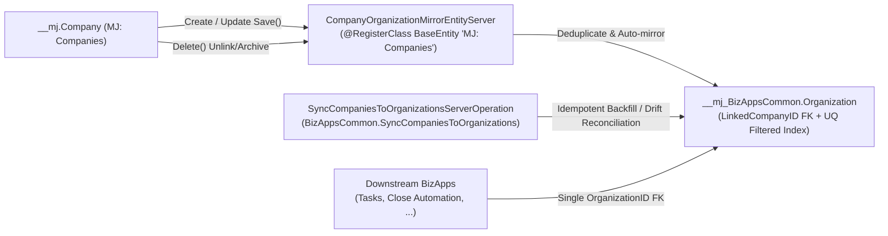

# Company → Organization Mirroring

BizApps Common bridges MemberJunction's core `MJ: Companies` table (`__mj.Company`) into the canonical `MJ_BizApps_Common: Organizations` directory (`__mj_BizAppsCommon.Organization`) via a nullable, uniquely indexed `LinkedCompanyID` foreign key.

This follows the exact same architectural symmetry as `Person.LinkedUserID → __mj.User(ID)`:

| Core MJ Table | BizApps Common Mirror | Link Column | Uniqueness |
| :--- | :--- | :--- | :--- |
| `__mj.User` | `__mj_BizAppsCommon.Person` | `Person.LinkedUserID` | Filtered unique (`WHERE LinkedUserID IS NOT NULL`) |
| `__mj.Company` | `__mj_BizAppsCommon.Organization` | `Organization.LinkedCompanyID` | Filtered unique (`WHERE LinkedCompanyID IS NOT NULL`) |

---

## Why Canonical Organizations?

Downstream BizApps (Tasks, Close Automation, Relationship Management, Meetings, Committees, etc.) need to scope work and records to **both**:
1. **Internal operating entities / tenants** (defined in `__mj.Company`, such as *Meridian US LLC* or *Meridian UK Ltd*), and
2. **External organizations** (clients, vendors, partners, subsidiaries — such as *Acme Enterprise Corp*) that do not belong in `__mj.Company`.

By mirroring every `MJ: Companies` row into `MJ_BizApps_Common: Organizations`, downstream applications only ever need a single nullable `OrganizationID` foreign key (`FK → __mj_BizAppsCommon.Organization(ID)`). Internal companies remain unmistakably distinguishable (`Organization.LinkedCompanyID != null`) while sharing the same pickers, filters, permissions, and record links as external organizations.

---

## Architecture



---

## Components

### 1. Database Schema (`V202611201420__v5.69.x__Organization_LinkedCompanyID.sql`)
- Adds nullable `LinkedCompanyID UNIQUEIDENTIFIER NULL` to `[__mj_BizAppsCommon].[Organization]` with `FK_Organization_LinkedCompany` referencing `[__mj].[Company]([ID])`.
- Adds filtered unique index `UQ_Organization_LinkedCompanyID` (`WHERE [LinkedCompanyID] IS NOT NULL`) so at most one Organization mirrors a given Company while any number of external Organizations can have `LinkedCompanyID = NULL`.
- Regenerates `vwOrganizations`, `spCreateOrganization`, `spUpdateOrganization`, and CodeGen entity properties (`LinkedCompanyID`, `LinkedCompany`).

### 2. Server-Side Auto-Mirroring & Delete Unlink (`CompanyOrganizationMirrorEntityServer`)
Located in [`packages/CoreEntitiesServer/src/CompanyOrganizationMirrorServer.ts`](../packages/CoreEntitiesServer/src/CompanyOrganizationMirrorServer.ts) and registered via `@RegisterClass(BaseEntity, 'MJ: Companies')`, backed by pure dual-dialect helpers in [`packages/Entities/src/company-organization-mirror.ts`](../packages/Entities/src/company-organization-mirror.ts).

- **Pre-create deduplication (`Save()`):** Queries `MJ_BizApps_Common: Organizations` via `RunView.FromMetadataProvider(provider).RunView` with `ResultType: 'simple'` and a dual-dialect ANSI SQL `ExtraFilter` (`BuildOrganizationMirrorLookupFilter`) checking `LinkedCompanyID` first and then unlinked rows matching normalized `Name`, `LegalName`, or `WebsiteDomain`. Links a unique existing match (`LinkedExistingOrganization: true`), rejects ties deterministically with `AMBIGUOUS_ORGANIZATION_MATCH`, and creates a new `Active` Organization only when no match exists.
- **Structured error surfacing:** `TryMirrorCompanyToOrganization` / `TryUnlinkOrganizationForDeletedCompany` return discriminated result unions (`CompanyMirrorResult`, `CompanyUnlinkResult`) with typed `CompanyMirrorErrorDetails` (`Code`, `Context`, `DiagnosticMessage`, `Cause`). `CompanyOrganizationMirrorEntityServer.Save()` and `.Delete()` surface failures deterministically via `LastMirrorError`, `BaseEntity.LatestResult`, and `LogError` (returning `false` on mirror/unlink failure).
- **Deterministic delete unlink/archive (`Delete()`):** Prior to `super.Delete()`, queries linked Organizations (`LinkedCompanyID = '<companyId>'`), clears `LinkedCompanyID = null`, transitions `'Active'` records to `'Inactive'` (preserving `'Dissolved'` / `'Inactive'` without regression, configurable via `RegisterCompanyMirrorDeletePolicy`), coordinates writes via `EntityTransactionScope` / `TransactionGroup`, and aborts deletion if unlinking fails so shared internal Organizations are never orphaned or destroyed.

### 3. Remotable Operation (`BizAppsCommon.SyncCompaniesToOrganizations`)
- **Typed client/server contract:** [`SyncCompaniesToOrganizationsOperation`](../packages/Entities/src/company-organization-sync.operation.ts) in `@mj-biz-apps/common-entities`.
- **Server handler:** [`SyncCompaniesToOrganizationsServerOperation`](../packages/CoreEntitiesServer/src/CompanyOrganizationMirrorServer.ts) in `@mj-biz-apps/common-core-entities-server`.
- **Authorization & Exposure:** `AuthorizedWriteEntities = ['MJ_BizApps_Common: Organizations']`, `ExposeAsAgentTool = true`, `ExposeAsMCPTool = true`.

#### Calling from TypeScript (Browser or Server)

```typescript
import { SyncCompaniesToOrganizationsOperation } from '@mj-biz-apps/common-entities';

// Reconcile / backfill all MJ: Companies rows idempotently
const result = await new SyncCompaniesToOrganizationsOperation().Execute({});

if (result.Success && result.Output) {
    console.log(
        `Synced ${result.Output.TotalCompanies} companies ` +
        `(created=${result.Output.CreatedCount}, updated=${result.Output.UpdatedCount}, unchanged=${result.Output.UnchangedCount})`,
    );
}

// Or reconcile a single MJ: Company by ID
const single = await new SyncCompaniesToOrganizationsOperation().Execute({
    CompanyID: '34994834-6299-41EF-ACC8-7FB1694A9C99',
});
```

---

## Testing

- **Entity Unit & Static Hygiene Tests (`@mj-biz-apps/common-entities`):**
  - `packages/Entities/src/__tests__/organization-mirror-dedup.test.ts`
  - `packages/Entities/src/__tests__/mirror-error-contract.test.ts`
  - `packages/Entities/src/__tests__/company-delete-unlink.test.ts`
  - `packages/Entities/src/__tests__/mirror-hygiene.test.ts`
- **Server Lifecycle Unit Tests (`@mj-biz-apps/common-server`):**
  - `packages/Server/src/__tests__/company-organization-mirror.test.ts`
  - `packages/Server/src/__tests__/company-mirror-sync.test.ts`
  - `packages/Server/src/__tests__/company-delete-unlink.test.ts`
- **Live GraphQL Integration Tests:**
  ```bash
  pnpm --filter @mj-biz-apps/common-integration-tests build
  node test-harnesses/integration.mjs company-org-mirror
  ```
  Covers `CM1` (create auto-mirror), `CM2` (update propagation), `CM3` (idempotent RPC & drift reconciliation), and `CM4` (`UQ_Organization_LinkedCompanyID` uniqueness enforcement + multi-external coexistence).
