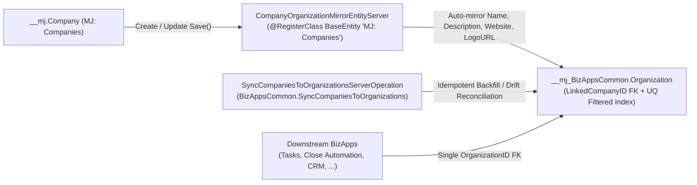

# Company → Organization Mirroring

BizApps Common bridges MemberJunction's core `MJ: Companies` table (`__mj.Company`) into the canonical `MJ_BizApps_Common: Organizations` directory (`__mj_BizAppsCommon.Organization`) via a nullable, uniquely indexed `LinkedCompanyID` foreign key.

This follows the exact same architectural symmetry as `Person.LinkedUserID → __mj.User(ID)`:

| Core MJ Table | BizApps Common Mirror | Link Column | Uniqueness |
| :--- | :--- | :--- | :--- |
| `__mj.User` | `__mj_BizAppsCommon.Person` | `Person.LinkedUserID` | Filtered unique (`WHERE LinkedUserID IS NOT NULL`) |
| `__mj.Company` | `__mj_BizAppsCommon.Organization` | `Organization.LinkedCompanyID` | Filtered unique (`WHERE LinkedCompanyID IS NOT NULL`) |

---

## Why Canonical Organizations?

Downstream BizApps (Tasks, Close Automation, CRM, Meetings, Committees, etc.) need to scope work and records to **both**:
1. **Internal operating entities / tenants** (defined in `__mj.Company`, such as *Blue Cypress US LLC* or *Blue Cypress UK Ltd*), and
2. **External organizations** (clients, vendors, partners, subsidiaries — such as *Acme Enterprise Corp*) that do not belong in `__mj.Company`.

By mirroring every `MJ: Companies` row into `MJ_BizApps_Common: Organizations`, downstream applications only ever need a single nullable `OrganizationID` foreign key (`FK → __mj_BizAppsCommon.Organization(ID)`). Internal companies remain unmistakably distinguishable (`Organization.LinkedCompanyID != null`) while sharing the same pickers, filters, permissions, and record links as external organizations.

---

## Architecture



---

## Components

### 1. Database Schema (`V202611201420__v5.69.x__Organization_LinkedCompanyID.sql`)
- Adds nullable `LinkedCompanyID UNIQUEIDENTIFIER NULL` to `[__mj_BizAppsCommon].[Organization]` with `FK_Organization_LinkedCompany` referencing `[__mj].[Company]([ID])`.
- Adds filtered unique index `UQ_Organization_LinkedCompanyID` (`WHERE [LinkedCompanyID] IS NOT NULL`) so at most one Organization mirrors a given Company while any number of external Organizations can have `LinkedCompanyID = NULL`.
- Regenerates `vwOrganizations`, `spCreateOrganization`, `spUpdateOrganization`, and CodeGen entity properties (`LinkedCompanyID`, `LinkedCompany`).

### 2. Server-Side Auto-Mirroring (`CompanyOrganizationMirrorEntityServer`)
Located in [`packages/CoreEntitiesServer/src/CompanyOrganizationMirrorServer.ts`](../packages/CoreEntitiesServer/src/CompanyOrganizationMirrorServer.ts) and registered via `@RegisterClass(BaseEntity, 'MJ: Companies')`.

- Runs automatically after every successful `MJ: Companies` `Save()`.
- Creates a new `Active` `MJ_BizApps_Common: Organizations` row when no row is linked to `Company.ID`.
- Updates mirrored fields (`Name`, `Website`, `LogoURL`, `Description`) when values drift, and skips redundant saves when unchanged.
- **Fault isolation:** Mirroring errors are logged via `LogError` and never fail the core `MJ: Companies` write; callers can reconcile at any time via the Remotable Operation below.

### 3. Remotable Operation (`BizAppsCommon.SyncCompaniesToOrganizations`)
- **Typed client/server contract:** [`SyncCompaniesToOrganizationsOperation`](../packages/Entities/src/company-organization-sync.operation.ts) in `@mj-biz-apps/common-entities`.
- **Server handler:** [`SyncCompaniesToOrganizationsServerOperation`](../packages/CoreEntitiesServer/src/CompanyOrganizationMirrorServer.ts) in `@mj-biz-apps/common-core-entities-server`.
- **Authorization & Exposure:** `AuthorizedWriteEntities = ['MJ_BizApps_Common: Organizations']`, `ExposeAsAgentTool = true`, `ExposeAsMCPTool = true`.

#### Calling from TypeScript (Browser or Server)

```typescript
import { SyncCompaniesToOrganizationsOperation } from '@mj-biz-apps/common-entities';

// Reconcile / backfill all MJ: Companies rows idempotently
const result = await new SyncCompaniesToOrganizationsOperation().Execute({});

if (result.Success && result.Output) {
    console.log(
        `Synced ${result.Output.TotalCompanies} companies ` +
        `(created=${result.Output.CreatedCount}, updated=${result.Output.UpdatedCount}, unchanged=${result.Output.UnchangedCount})`,
    );
}

// Or reconcile a single MJ: Company by ID
const single = await new SyncCompaniesToOrganizationsOperation().Execute({
    CompanyID: '34994834-6299-41EF-ACC8-7FB1694A9C99',
});
```

---

## Testing

- **Unit Tests:** `pnpm --filter @mj-biz-apps/common-server test` (`packages/Server/src/__tests__/company-organization-mirror.test.ts`)
- **Live GraphQL Integration Tests:**
  ```bash
  pnpm --filter @mj-biz-apps/common-integration-tests build
  node test-harnesses/integration.mjs company-org-mirror
  ```
  Covers `CM1` (create auto-mirror), `CM2` (update propagation), `CM3` (idempotent RPC & drift reconciliation), and `CM4` (`UQ_Organization_LinkedCompanyID` uniqueness enforcement + multi-external coexistence).
